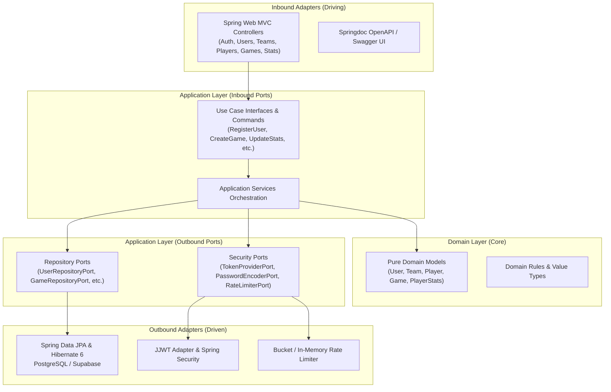

# bcmServer (Basket Club Manager Server)

[](https://openjdk.org/projects/jdk/21/)
[](https://spring.io/projects/spring-boot)
[](https://www.postgresql.org/)
[](https://flywaydb.org/)
[](https://swagger.io/specification/)

A modular, high-performance REST API backend powering the Basket Club Manager (BCM) ecosystem. Engineered with **Hexagonal Architecture (Ports and Adapters)**, strict domain isolation, stateless JWT security, Flyway-managed schema migrations, and real-time basketball game statistics.

---

## Table of Contents

- [Overview](#overview)
- [Documentation Suite](#documentation-suite)
- [Architecture](#architecture)
- [Key Features](#key-features)
- [Technology Stack](#technology-stack)
- [Prerequisites](#prerequisites)
- [Getting Started](#getting-started)
- [Configuration](#configuration)
- [API Reference](#api-reference)
- [Project Structure](#project-structure)
- [Testing & Quality](#testing--quality)

---

## Overview

**bcmServer** serves as the central backend engine for basketball clubs. It provides end-to-end management of:
- **Club Rosters & Teams**: Categories, team rosters, and player profiles.
- **Game Operations**: Quarter-by-quarter scoreboards (Q1–Q4, Overtime), team & opponent fouls, and live game states (`pending`, `live`, `finished`).
- **Granular Box-Score Analytics**: Complete per-player, per-game statistics tracking shooting accuracy (1PT, 2PT, 3PT attempted/made), rebounds (offensive & defensive), assists, steals, turnovers, blocks, fouls, playing time, and PIR (Player Efficiency Rating / Valuation).
- **Stateless Authentication**: High-security token issuance and verification with in-memory request throttling.

---

## Documentation Suite

Detailed guides and manuals are available in the [`docs/`](file:///j:/GitHub/BasketApp/bcmServer/docs/README.md) directory:

- [**Architecture & Design Guide**](file:///j:/GitHub/BasketApp/bcmServer/docs/architecture.md): Hexagonal layers, domain isolation, sequence diagrams, and Architecture Decision Records (ADRs).
- [**API Reference Manual**](file:///j:/GitHub/BasketApp/bcmServer/docs/api_reference.md): Endpoint reference, JSON schemas, RFC 7807 problem details, rate limits, and curl examples.
- [**Data Models & Database Schema**](file:///j:/GitHub/BasketApp/bcmServer/docs/data_models.md): PostgreSQL schema contracts, Flyway migrations (`V1`–`V6`), ER diagram, and PIR valuation formulas.
- [**Operational Runbook**](file:///j:/GitHub/BasketApp/bcmServer/docs/runbook.md): Operations guide, Supabase IPv4 pooler setup, Flyway repairs, secret rotation, actuator health monitoring, and incident triage.
- [**Developer Onboarding Guide**](file:///j:/GitHub/BasketApp/bcmServer/docs/onboarding.md): Quickstart setup, IDE annotation processing for MapStruct, tutorial on creating new hexagonal features, and test execution.

---

## Architecture

The system strictly follows **Hexagonal Architecture (Ports and Adapters)** to decouple domain rules from infrastructure and frameworks:



- **Domain Core**: Pure Java 21 business objects (`com.basketapp.bcmserver.domain`) with **zero** dependencies on Spring, JPA, or external frameworks.
- **Application Layer**: Inbound use cases (`port.in`) and outbound dependencies (`port.out`) coordinated by application services.
- **Infrastructure Layer**: Concrete web controllers (`adapter.in.web`), persistence entities and repositories (`adapter.out.persistence`), security adapters (`adapter.out.security`), and configuration beans.
- **Boundary Mappers**: Compile-time MapStruct mappers ensure JPA entities, web DTOs, and domain models never leak across layers.

---

## Key Features

- **Stateless JWT Authentication & Security**: Centralized Spring Security filter chain with JJWT 0.12.x bearer tokens, BCrypt password hashing, and role-based access control.
- **Authentication Rate Limiting**: Built-in sliding rate limiters protecting `/api/v1/auth/register` and `/api/v1/auth/login` from brute-force attempts.
- **Complete Basketball Domain Engine**:
  - Teams & Categories (`/api/v1/teams`).
  - Players & Rosters (`/api/v1/players`).
  - Match Schedule & Live Scoreboards (`/api/v1/games`) with quarter breakdowns and foul counts.
  - Deep Box Scores (`/api/v1/player-stats`) capturing shooting accuracy (1PT, 2PT, 3PT made/attempted), offensive/defensive rebounds, assists, steals, turnovers, blocks, and fouls.
- **PostgreSQL & Flyway Versioning**: Schema evolution controlled via sequential Flyway migrations (`V1` to `V6`). Hibernate DDL auto-generation is disabled (`ddl-auto: none`) to ensure database safety.
- **Hybrid Cloud & Supabase Ready**: Native configuration support for local Docker PostgreSQL as well as remote Supabase instances (via session pooler, transaction pooler on port 6543, or direct connection).
- **Startup Connection Verification**: A fail-fast `DatabaseConnectionVerifier` tests connection validity, measures roundtrip latency, and logs database metadata upon boot.
- **Interactive OpenAPI 3 & Swagger**: Automated REST documentation available out of the box at `/swagger-ui.html`.
- **RFC 7807 Problem Details**: Standardized error responses across all REST controllers.

---

## Technology Stack

| Component | Technology | Version | Description |
| :--- | :--- | :--- | :--- |
| **Language** | Java | 21 (LTS) | Modern Java records, pattern matching, and sealed types |
| **Framework** | Spring Boot | 3.4.2 | REST, Actuator, and Dependency Injection |
| **Security** | Spring Security & JJWT | 6.x / 0.12.6 | Stateless JWT authorization & BCrypt hashing |
| **Persistence** | Spring Data JPA / Hibernate | 6.x | Relational mapping isolated within persistence adapters |
| **Database** | PostgreSQL | 16-alpine | Primary relational transactional database |
| **Migrations** | Flyway | 10.x | Deterministic, version-controlled schema migrations |
| **Mapping** | MapStruct | 1.6.3 | Compile-time, zero-reflection entity-DTO mapping |
| **Documentation** | Springdoc OpenAPI | 2.8.4 | Interactive Swagger UI and OpenAPI v3 documentation |
| **Configuration** | Dotenv Java | 3.2.0 | Automatic `.env` loading for seamless local workflows |
| **Containerization** | Docker & Docker Compose | Compose v2 | Containerized local PostgreSQL database |

---

## Prerequisites

- **Java Development Kit (JDK)**: Version 21 or higher installed. Verify with:
  ```bash
  java -version
  ```
- **Docker & Docker Compose**: For running the local PostgreSQL container. Verify with:
  ```bash
  docker compose version
  ```
- **Maven**: 3.9+ (or use the included `./mvnw` / `mvnw.cmd` wrapper).

---

## Getting Started

### 1. Clone and Navigate

```bash
git clone https://github.com/BasketApp/bcmServer.git
cd bcmServer
```

### 2. Configure Environment Variables

Create your local `.env` configuration from the provided template:

```bash
# On Linux / macOS
cp .env.example .env

# On Windows PowerShell
Copy-Item .env.example .env
```

### 3. Start PostgreSQL Service

Spin up the containerized PostgreSQL database:

```bash
docker compose up -d
```

Verify that the database container is healthy:

```bash
docker compose ps
```

### 4. Run the Application

Execute using the Maven wrapper:

```bash
# On Linux / macOS
./mvnw spring-boot:run

# On Windows PowerShell / CMD
.\mvnw.cmd spring-boot:run
```

Once started, the server will be available at `http://localhost:8080`.

> [!TIP]
> Flyway executes all pending database migrations automatically on application startup.

---

## Configuration

All application properties are externalized via environment variables and loaded automatically from the `.env` file or environment.

| Variable | Default Value | Description |
| :--- | :--- | :--- |
| `SERVER_PORT` | `8080` | HTTP port for the Spring Boot server |
| `SPRING_PROFILES_ACTIVE` | `dev` | Active Spring profile (`dev`, `prod`, `test`) |
| `DB_HOST` | `localhost` | PostgreSQL host |
| `DB_PORT` | `5432` | PostgreSQL port |
| `DB_NAME` | `bcm_db` | PostgreSQL database name |
| `DB_USERNAME` | `postgres` | Database user |
| `DB_PASSWORD` | `postgres` | Database password |
| `DB_QUERY_PARAMS` | *(empty)* | Optional JDBC parameters (e.g. `?sslmode=require`) |
| `DB_URL` | *(composite)* | Explicit JDBC URL (overrides individual `DB_*` settings) |
| `JWT_SECRET` | *(64-char key)* | HMAC-SHA secret key for JWT signing |
| `JWT_EXPIRATION_MS` | `86400000` | JWT token validity window in milliseconds (24 hours) |
| `RATE_LIMIT_REGISTRATION_MAX` | `5` | Maximum registration attempts per window |
| `RATE_LIMIT_REGISTRATION_WINDOW`| `60` | Registration rate limit window in seconds |
| `RATE_LIMIT_LOGIN_MAX` | `5` | Maximum login attempts per window |
| `RATE_LIMIT_LOGIN_WINDOW` | `60` | Login rate limit window in seconds |

> [!IMPORTANT]
> Always generate a secure, 256-bit random hexadecimal string for `JWT_SECRET` in staging and production environments.

### Connecting to Supabase

To connect to a managed Supabase database instead of local Docker:

```properties
# Supabase Transaction Pooler (Recommended for IPv4 environments)
DB_HOST=aws-0-[region].pooler.supabase.com
DB_PORT=6543
DB_NAME=postgres
DB_USERNAME=postgres.[project-ref]
DB_PASSWORD=[your-db-password]
DB_QUERY_PARAMS=?sslmode=require
```

> [!NOTE]
> Direct connections to `db.[project-ref].supabase.co` on port `5432` require IPv6 network routing. When running in IPv4-only networks, always connect via the Supabase pooler host on port `6543`.

---

## API Reference

### Interactive Documentation & Diagnostics

- **Swagger UI**: [http://localhost:8080/swagger-ui.html](http://localhost:8080/swagger-ui.html)
- **OpenAPI 3 JSON Spec**: [http://localhost:8080/v3/api-docs](http://localhost:8080/v3/api-docs)
- **Actuator Health Check**: [http://localhost:8080/actuator/health](http://localhost:8080/actuator/health)

### Core Endpoints

#### Authentication & Accounts

| Method | Endpoint | Auth | Description |
| :--- | :--- | :---: | :--- |
| `POST` | `/api/v1/auth/register` | No | Register a new user account |
| `POST` | `/api/v1/auth/login` | No | Authenticate user and receive Bearer JWT |
| `GET` | `/api/v1/users/me` | Bearer | Retrieve profile of currently authenticated user |
| `GET` | `/api/v1/users/{id}` | Bearer | Retrieve user details by ID |
| `PUT` | `/api/v1/users/{id}` | Bearer | Update user credentials or profile information |
| `DELETE`| `/api/v1/users/{id}` | Bearer | Delete user account |

#### Teams & Rosters

| Method | Endpoint | Auth | Description |
| :--- | :--- | :---: | :--- |
| `GET` | `/api/v1/teams` | Bearer | List all registered teams |
| `POST` | `/api/v1/teams` | Bearer | Create a new basketball team |
| `GET` | `/api/v1/teams/{id}` | Bearer | Get team details by ID |
| `PUT` | `/api/v1/teams/{id}` | Bearer | Update team name or category |
| `DELETE`| `/api/v1/teams/{id}` | Bearer | Remove team |

#### Players

| Method | Endpoint | Auth | Description |
| :--- | :--- | :---: | :--- |
| `GET` | `/api/v1/players` | Bearer | List players (supports `?teamId={id}`) |
| `POST` | `/api/v1/players` | Bearer | Register player and assign to a team |
| `GET` | `/api/v1/players/{id}` | Bearer | Get player profile by ID |
| `PUT` | `/api/v1/players/{id}` | Bearer | Update player details (jersey number, name) |
| `DELETE`| `/api/v1/players/{id}` | Bearer | Remove player |

#### Games & Live Scoring

| Method | Endpoint | Auth | Description |
| :--- | :--- | :---: | :--- |
| `GET` | `/api/v1/games` | Bearer | List games (supports `?teamId={id}&status={status}`) |
| `POST` | `/api/v1/games` | Bearer | Schedule a new match |
| `GET` | `/api/v1/games/{id}` | Bearer | Get game scoreboard, quarter scores, and fouls |
| `PUT` | `/api/v1/games/{id}` | Bearer | Update live game scores, fouls, or status |
| `DELETE`| `/api/v1/games/{id}` | Bearer | Delete a game record |

#### Player Statistics (Box Scores)

| Method | Endpoint | Auth | Description |
| :--- | :--- | :---: | :--- |
| `GET` | `/api/v1/player-stats` | Bearer | List stats (supports `?gameId={id}&playerId={id}`) |
| `POST` | `/api/v1/player-stats` | Bearer | Record box-score stats for a player in a game |
| `GET` | `/api/v1/player-stats/{id}` | Bearer | Get specific player-game statistical record |
| `PUT` | `/api/v1/player-stats/{id}` | Bearer | Update game stats (shots, rebounds, fouls, time) |
| `DELETE`| `/api/v1/player-stats/{id}` | Bearer | Delete statistical record |

---

## Project Structure

```text
bcmServer/
├── .mvn/                              # Maven wrapper configuration
├── docker-compose.yml                 # Local PostgreSQL 16 container definition
├── pom.xml                            # Project dependencies and build configuration
├── .env.example                       # Environment configuration template
└── src/
    ├── main/
    │   ├── java/com/basketapp/bcmserver/
    │   │   ├── BcmServerApplication.java
    │   │   ├── domain/                # Pure domain layer (Hexagon Core)
    │   │   │   ├── model/             # Entities: User, Team, Player, Game, PlayerStats
    │   │   │   └── exception/         # Domain-level business exceptions
    │   │   ├── application/           # Ports & use cases
    │   │   │   ├── port/in/           # Driving interfaces (Use Cases & Commands)
    │   │   │   ├── port/out/          # Driven interfaces (Repository & Security Ports)
    │   │   │   └── service/           # Application service orchestration
    │   │   └── infrastructure/        # Adapters layer (Outside the Hexagon)
    │   │       ├── adapter/in/web/    # REST controllers, DTOs, mappers, filters
    │   │       ├── adapter/out/       # JPA repositories, JJWT token provider, rate limiter
    │   │       └── config/            # Dotenv loader, security chain, DB verifier
    │   └── resources/
    │       ├── application.yml        # Base Spring configuration
    │       ├── application-dev.yml    # Development profile settings
    │       └── db/migration/          # Flyway SQL schema migrations (V1 - V6)
    └── test/                          # Unit, integration, and security slice tests
```

---

## Testing & Quality

The testing strategy validates all rings of the Hexagon:
- **Unit Tests**: Domain entities and application services tested in pure Java 21 with JUnit 5 and Mockito (no Spring context overhead).
- **Web Slice Tests**: `@WebMvcTest` controllers verifying input validation, status codes, and security filters.
- **Persistence & Migration Tests**: JPA adapter tests and Flyway migration verification.

### Run Tests

```bash
# Execute entire test suite
./mvnw test

# On Windows
.\mvnw.cmd test
```

### Packaging

To build the executable, production-ready JAR:

```bash
./mvnw clean package -DskipTests
java -jar target/bcmServer-0.0.1-SNAPSHOT.jar
```

