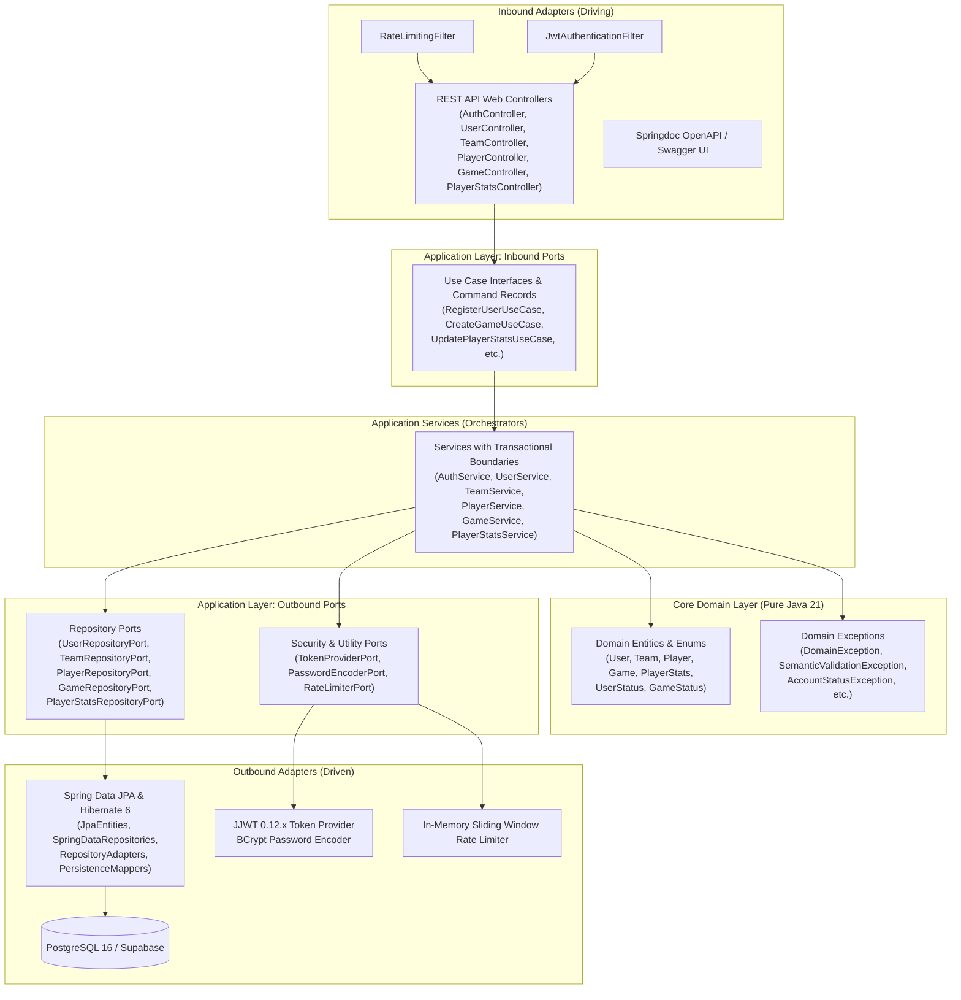
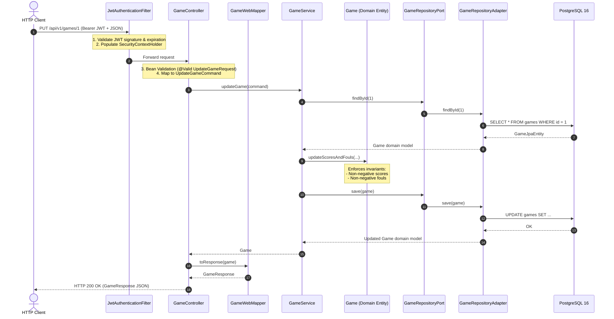
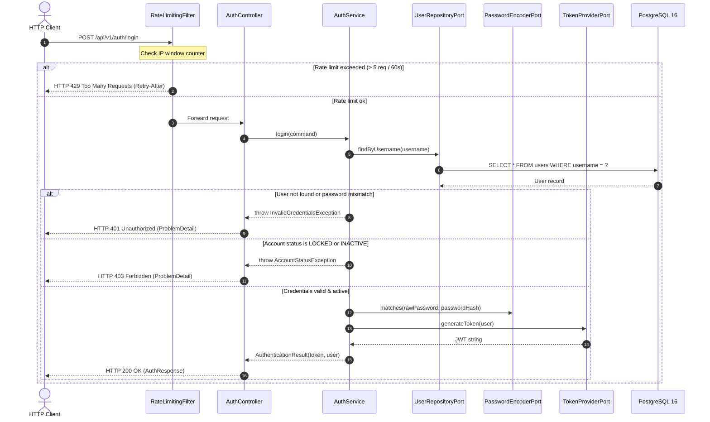

# bcmServer - Architecture & Design Specification

This document provides a comprehensive overview of the software architecture, design patterns, and engineering principles implemented in **bcmServer** (Basket Club Manager Server).

---

## 1. Architectural Philosophy: Hexagonal (Ports & Adapters)

**bcmServer** adheres to **Hexagonal Architecture** (also known as *Ports and Adapters*), formulated by Alistair Cockburn. The primary objective is to decouple core business logic from frameworks, persistence stores, transport layers, and third-party libraries.

### Core Hexagon Diagram



### Dependency Rule
Dependencies **only point inward**:
- **Domain**: Knows nothing about Spring, JPA, HTTP, or databases.
- **Application**: Knows domain models and defines ports (interfaces). Knows nothing about database schemas, HTTP status codes, or frameworks.
- **Infrastructure (Adapters)**: Implements inbound controllers and outbound repository adapters. It depends on the application layer, never the other way around.

---

## 2. Layer Structure & Responsibilities

```text
com.basketapp.bcmserver/
├── domain/                                  # CORE: Pure Java 21 domain models
│   ├── model/
│   │   ├── User.java                        # User entity & credentials
│   │   ├── UserStatus.java                  # Enum: ACTIVE, INACTIVE, LOCKED
│   │   ├── Team.java                        # Team entity & division
│   │   ├── Player.java                      # Player entity & jersey attributes
│   │   ├── Game.java                        # Game schedule, scores & fouls
│   │   ├── GameStatus.java                  # Enum: PENDING, LIVE, FINISHED
│   │   └── PlayerStats.java                 # Box-score statistics & PIR
│   └── exception/                           # Business domain exceptions
│       ├── DomainException.java             # Base unchecked domain exception
│       ├── AccountStatusException.java      # 403 Forbidden on locked/inactive
│       ├── InvalidCredentialsException.java # 401 Unauthorized
│       ├── RateLimitExceededException.java  # 429 Too Many Requests
│       ├── SemanticValidationException.java # 422 Unprocessable Entity
│       ├── UnauthorizedOperationException.java # 403 Forbidden
│       ├── UserAlreadyExistsException.java  # 409 Conflict
│       ├── UserNotFoundException.java       # 404 Not Found
│       ├── TeamNotFoundException.java       # 404 Not Found
│       ├── PlayerNotFoundException.java     # 404 Not Found
│       ├── GameNotFoundException.java       # 404 Not Found
│       └── PlayerStatsNotFoundException.java# 404 Not Found
│
├── application/                             # APPLICATION LAYER (Ports & Services)
│   ├── port/
│   │   ├── in/                              # Inbound Ports (Use Cases & Commands)
│   │   │   ├── RegisterUserUseCase.java & RegisterUserCommand.java
│   │   │   ├── LoginUserUseCase.java & LoginUserCommand.java
│   │   │   ├── CreateTeamUseCase.java, UpdateTeamUseCase.java, etc.
│   │   │   ├── CreatePlayerUseCase.java, UpdatePlayerUseCase.java, etc.
│   │   │   ├── CreateGameUseCase.java, UpdateGameUseCase.java, etc.
│   │   │   └── CreatePlayerStatsUseCase.java, UpdatePlayerStatsUseCase.java, etc.
│   │   └── out/                             # Outbound Ports (Driven Interfaces)
│   │       ├── UserRepositoryPort.java
│   │       ├── TeamRepositoryPort.java
│   │       ├── PlayerRepositoryPort.java
│   │       ├── GameRepositoryPort.java
│   │       ├── PlayerStatsRepositoryPort.java
│   │       ├── TokenProviderPort.java
│   │       ├── PasswordEncoderPort.java
│   │       └── RateLimiterPort.java
│   └── service/                             # Application Services (Use Case Implementation)
│       ├── AuthService.java                 # Login & Registration workflows
│       ├── UserService.java                 # Profile retrieval, update, deletion
│       ├── TeamService.java                 # Team roster operations
│       ├── PlayerService.java               # Player assignment and CRUD
│       ├── GameService.java                 # Schedule and live score updates
│       └── PlayerStatsService.java          # Individual statistics & PIR calculation
│
└── infrastructure/                          # ADAPTERS & INFRASTRUCTURE
    ├── adapter/
    │   ├── in/web/                          # REST Inbound Driving Adapters
    │   │   ├── AuthController.java          # /api/v1/auth
    │   │   ├── UserController.java          # /api/v1/users
    │   │   ├── TeamController.java          # /api/v1/teams
    │   │   ├── PlayerController.java        # /api/v1/players
    │   │   ├── GameController.java          # /api/v1/games
    │   │   ├── PlayerStatsController.java   # /api/v1/player-stats
    │   │   ├── dto/                         # Immutable request/response records
    │   │   ├── mapper/                      # MapStruct web mappers
    │   │   ├── filter/                      # Inbound servlet filters (Rate limiting)
    │   │   └── exception/                   # GlobalExceptionHandler (RFC 7807)
    │   └── out/                             # Outbound Driven Adapters
    │       ├── persistence/                 # JPA Repositories, Entities & Mappers
    │       ├── security/                    # JJWT Token Provider & BCrypt Adapter
    │       └── ratelimit/                   # In-memory sliding-window limiter
    └── config/                              # Spring configurations
        ├── SecurityConfig.java              # Security filter chain & rules
        ├── JwtAuthenticationFilter.java     # Stateless JWT parsing
        ├── OpenApiConfig.java               # Swagger & OpenAPI metadata
        ├── DatabaseConnectionVerifier.java  # Fail-fast startup connectivity check
        └── DotenvEnvironmentPostProcessor.java # .env file resolution
```

---

## 3. Request Flow & Execution Lifecycle

### Scenario A: Authenticated Domain Operation (e.g. Updating Game Score)



### Scenario B: Public Authentication with Rate Limiting (Login Flow)



---

## 4. Key Architectural Decisions (ADRs)

### ADR-01: Framework Isolation in the Domain
- **Decision**: Domain entities (`User`, `Team`, `Player`, `Game`, `PlayerStats`) contain no JPA, Hibernate, Jackson, or Spring annotations.
- **Rationale**: Isolates business invariants from framework bugs, library updates, or future migrations (e.g., migrating from JPA to JDBC/R2DBC or switching frameworks).

### ADR-02: Compile-Time Mapping with MapStruct
- **Decision**: Zero reflection-based object mapper (e.g., ModelMapper) is allowed. All translations between Web DTOs, Domain Entities, and JPA Entities are performed by MapStruct compile-time generated mappers.
- **Rationale**: Eliminates runtime reflection overhead, fails fast at compile time if fields are missing or incompatible, and produces zero-overhead bytecode.

### ADR-03: Deterministic Schema Management with Flyway
- **Decision**: Hibernate DDL auto-generation is disabled (`spring.jpa.hibernate.ddl-auto: none`). All schema modifications are handled by Flyway versioned SQL scripts (`V1` to `V6`).
- **Rationale**: Avoids dangerous DDL locks, unexpected table modifications in production, and provides an auditable history of the database schema.

### ADR-04: Startup Database Fail-Fast Verification
- **Decision**: A dedicated `DatabaseConnectionVerifier` runs at `Order(1)` upon application startup.
- **Rationale**: If PostgreSQL or Supabase is unreachable, misconfigured, or has invalid credentials, the server aborts bootstrapping immediately (< 10 seconds), preventing the deployment of broken instances.

### ADR-05: Standardized RFC 7807 Problem Details
- **Decision**: All REST error responses conform to `application/problem+json` (RFC 7807) using Spring's `ProblemDetail`.
- **Rationale**: Provides consistent, machine-readable error responses across all endpoints with structured fields (`title`, `status`, `detail`, `instance`, and optional `invalidParams`).

