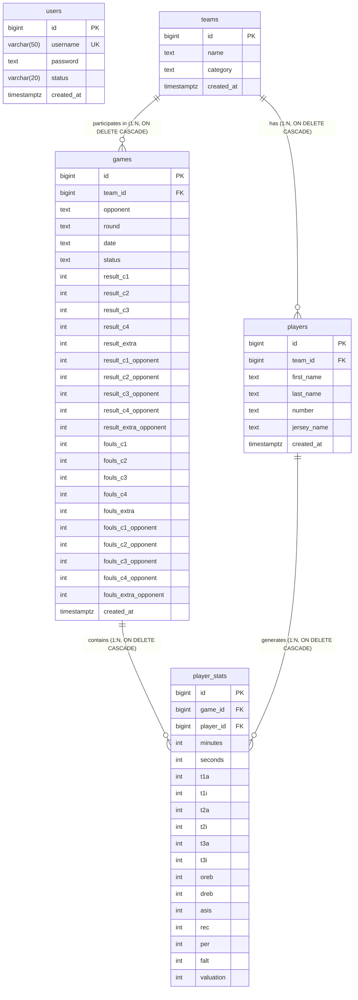

# BCM (Basket Club Manager) - Data Models & Schema Contracts

This document defines the authoritative database schema contract for PostgreSQL and Flyway migrations in **bcmServer**. Any domain model or JPA entity must strictly adhere to these definitions.

---

## 1. Relational Entity Graph

---

## 2. Server Database Tables (PostgreSQL 16)

### `users`
Identity and authentication records for administrators, coaches, and staff.
- **Migration**: `V1__create_users_table.sql`, `V6__add_user_status.sql`

| Column | PostgreSQL Type | Nullable | Default | Description / Constraints |
| :--- | :--- | :---: | :--- | :--- |
| `id` | `BIGSERIAL` | No | Auto | **PRIMARY KEY** |
| `username` | `VARCHAR(50)` | No | - | **UNIQUE**, user login handle (`idx_users_username`) |
| `password` | `TEXT` | No | - | BCrypt salted hash of password |
| `status` | `VARCHAR(20)` | No | `'ACTIVE'` | Account status: `ACTIVE`, `INACTIVE`, `LOCKED` (`idx_users_status`) |
| `created_at` | `TIMESTAMPTZ` | No | `CURRENT_TIMESTAMP` | Account creation timestamp in UTC |

---

### `teams`
Basketball club rosters grouped by division or age bracket.
- **Migration**: `V2__create_teams_table.sql`

| Column | PostgreSQL Type | Nullable | Default | Description / Constraints |
| :--- | :--- | :---: | :--- | :--- |
| `id` | `BIGSERIAL` | No | Auto | **PRIMARY KEY** |
| `name` | `TEXT` | No | - | Name of team (e.g., "Senior Masculino A", `idx_teams_name`) |
| `category` | `TEXT` | Yes | `NULL` | Division/category (e.g., "U18", "Senior Provincial") |
| `created_at` | `TIMESTAMPTZ` | No | `CURRENT_TIMESTAMP` | Timestamp of team creation in UTC |

---

### `players`
Athletes assigned to basketball teams.
- **Migration**: `V3__create_players_table.sql`

| Column | PostgreSQL Type | Nullable | Default | Description / Constraints |
| :--- | :--- | :---: | :--- | :--- |
| `id` | `BIGSERIAL` | No | Auto | **PRIMARY KEY** |
| `team_id` | `BIGINT` | No | - | **FOREIGN KEY** referencing `teams(id)` `ON DELETE CASCADE` (`idx_players_team_id`) |
| `first_name` | `TEXT` | No | - | Player's given name |
| `last_name` | `TEXT` | No | - | Player's family name |
| `number` | `TEXT` | No | - | Jersey number (e.g., "23", "00") |
| `jersey_name` | `TEXT` | Yes | `NULL` | Name displayed on the back of the jersey |
| `created_at` | `TIMESTAMPTZ` | No | `CURRENT_TIMESTAMP` | Registration timestamp in UTC |

---

### `games`
Basketball game scoreboards, schedule, status, quarter-by-quarter scoring, and fouls.
- **Migration**: `V4__create_games_table.sql`

| Column | PostgreSQL Type | Nullable | Default | Description / Constraints |
| :--- | :--- | :---: | :--- | :--- |
| `id` | `BIGSERIAL` | No | Auto | **PRIMARY KEY** |
| `team_id` | `BIGINT` | No | - | **FOREIGN KEY** referencing `teams(id)` `ON DELETE CASCADE` (`idx_games_team_id`) |
| `opponent` | `TEXT` | No | - | Name of the opposing team |
| `round` | `TEXT` | No | `'1'` | Tournament round / matchday identifier |
| `date` | `TEXT` | No | - | Scheduled date/time string (ISO-8601 or custom) |
| `status` | `TEXT` | No | `'pending'` | Match state: `pending`, `live`, `finished` |
| `created_at` | `TIMESTAMPTZ` | No | `CURRENT_TIMESTAMP` | Game record creation timestamp |
| **Home Scores** | | | | |
| `result_c1` | `INTEGER` | No | `0` | Quarter 1 points scored by home team |
| `result_c2` | `INTEGER` | No | `0` | Quarter 2 points scored by home team |
| `result_c3` | `INTEGER` | No | `0` | Quarter 3 points scored by home team |
| `result_c4` | `INTEGER` | No | `0` | Quarter 4 points scored by home team |
| `result_extra` | `INTEGER` | No | `0` | Overtime points scored by home team |
| **Opponent Scores** | | | | |
| `result_c1_opponent` | `INTEGER` | No | `0` | Quarter 1 points scored by opponent |
| `result_c2_opponent` | `INTEGER` | No | `0` | Quarter 2 points scored by opponent |
| `result_c3_opponent` | `INTEGER` | No | `0` | Quarter 3 points scored by opponent |
| `result_c4_opponent` | `INTEGER` | No | `0` | Quarter 4 points scored by opponent |
| `result_extra_opponent` | `INTEGER` | No | `0` | Overtime points scored by opponent |
| **Home Fouls** | | | | |
| `fouls_c1` | `INTEGER` | No | `0` | Quarter 1 team fouls committed |
| `fouls_c2` | `INTEGER` | No | `0` | Quarter 2 team fouls committed |
| `fouls_c3` | `INTEGER` | No | `0` | Quarter 3 team fouls committed |
| `fouls_c4` | `INTEGER` | No | `0` | Quarter 4 team fouls committed |
| `fouls_extra` | `INTEGER` | No | `0` | Overtime team fouls committed |
| **Opponent Fouls** | | | | |
| `fouls_c1_opponent` | `INTEGER` | No | `0` | Quarter 1 fouls committed by opponent |
| `fouls_c2_opponent` | `INTEGER` | No | `0` | Quarter 2 fouls committed by opponent |
| `fouls_c3_opponent` | `INTEGER` | No | `0` | Quarter 3 fouls committed by opponent |
| `fouls_c4_opponent` | `INTEGER` | No | `0` | Quarter 4 fouls committed by opponent |
| `fouls_extra_opponent`| `INTEGER` | No | `0` | Overtime fouls committed by opponent |

---

### `player_stats`
Granular per-game, per-player statistical box scores.
- **Migration**: `V5__create_player_stats_table.sql`

| Column | PostgreSQL Type | Nullable | Default | Description / Constraints |
| :--- | :--- | :---: | :--- | :--- |
| `id` | `BIGSERIAL` | No | Auto | **PRIMARY KEY** |
| `game_id` | `BIGINT` | No | - | **FOREIGN KEY** referencing `games(id)` `ON DELETE CASCADE` |
| `player_id` | `BIGINT` | No | - | **FOREIGN KEY** referencing `players(id)` `ON DELETE CASCADE` |
| `minutes` | `INTEGER` | No | `0` | Playing time minutes (>= 0) |
| `seconds` | `INTEGER` | No | `0` | Playing time seconds (0 to 59) |
| `t1a` | `INTEGER` | No | `0` | 1-point free throws attempted (>= 0) |
| `t1i` | `INTEGER` | No | `0` | 1-point free throws made / scored (`t1i <= t1a`) |
| `t2a` | `INTEGER` | No | `0` | 2-point field goals attempted (>= 0) |
| `t2i` | `INTEGER` | No | `0` | 2-point field goals made / scored (`t2i <= t2a`) |
| `t3a` | `INTEGER` | No | `0` | 3-point field goals attempted (>= 0) |
| `t3i` | `INTEGER` | No | `0` | 3-point field goals made / scored (`t3i <= t3a`) |
| `oreb` | `INTEGER` | No | `0` | Offensive rebounds |
| `dreb` | `INTEGER` | No | `0` | Defensive rebounds |
| `asis` | `INTEGER` | No | `0` | Assists |
| `rec` | `INTEGER` | No | `0` | Steals / Recoveries |
| `per` | `INTEGER` | No | `0` | Turnovers / Ball losses |
| `falt` | `INTEGER` | No | `0` | Personal fouls committed |
| `valuation` | `INTEGER` | No | `0` | Performance Index Rating (PIR) |

#### Indexes on `player_stats`:
- `idx_player_stats_game_id`: Fast lookup of box-scores by match.
- `idx_player_stats_player_id`: Fast lookup of player history across matches.
- `idx_player_stats_game_player`: Composite index for matching player-game pairs.

#### Basketball PIR (Valuation) Reference Formula:
$$
\begin{aligned}
\text{Points} &= (1 \times \text{t1i}) + (2 \times \text{t2i}) + (3 \times \text{t3i}) \\
\text{Missed FT} &= \text{t1a} - \text{t1i} \\
\text{Missed 2PT} &= \text{t2a} - \text{t2i} \\
\text{Missed 3PT} &= \text{t3a} - \text{t3i} \\
\text{Total Missed FG} &= \text{Missed FT} + \text{Missed 2PT} + \text{Missed 3PT} \\
\text{PIR} &= (\text{Points} + \text{oreb} + \text{dreb} + \text{asis} + \text{rec}) - (\text{Total Missed FG} + \text{per} + \text{falt})
\end{aligned}
$$

---

## 3. Client Local Storage Models (Not Stored on Server)

The following tables are intended for client-side offline storage (e.g. mobile app SQLite / Room / local cache):

### `notifications` (Client Only)
| Column | Type | Description |
| :--- | :--- | :--- |
| `id` | SERIAL / INTEGER PK | Local notification ID |
| `external_id` | TEXT | Push provider ID (e.g. Firebase) |
| `title` / `body` | TEXT | Notification payload |
| `data_json` | JSONB / TEXT | Custom payload |
| `received_at` | TIMESTAMPTZ | UTC timestamp |
| `is_read` | BOOLEAN | Read flag |
| `suppressed_reason` | TEXT | Reason if muted |

### `notification_settings` (Client Only)
Singleton record (`id=1`) for local notification preferences (`mute_in_app`, `mute_in_match`, `sound_enabled`).

### `match_cache` (Client / Ephemeral)
Cached serialized live match JSON (`state_json`, `version`, `last_updated`).
