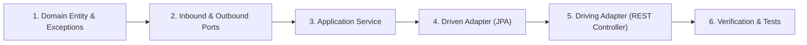

# bcmServer - Developer Onboarding Guide

Welcome to **bcmServer**! This guide will help you set up your local development environment and walk you through developing new features following our hexagonal architecture patterns.

---

## 1. Prerequisites

Before starting, ensure you have the following installed on your machine:
- **Java Development Kit (JDK) 21** or higher (Eclipse Temurin, OpenJDK, or Amazon Corretto).
- **Docker & Docker Compose** (for running the local PostgreSQL container).
- **Git**.
- **IDE**: IntelliJ IDEA (Ultimate or Community) or VS Code with the Java Extension Pack.

Verify your setup:
```bash
java -version    # Must output 21+
docker --version # Must be installed and running
git --version
```

---

## 2. Quickstart (< 5 Minutes)

### Step 1: Clone Repository
```bash
git clone https://github.com/BasketApp/bcmServer.git
cd bcmServer
```

### Step 2: Initialize Configuration
Copy `.env.example` to `.env`:
```bash
# Linux / macOS
cp .env.example .env

# Windows PowerShell
Copy-Item .env.example .env
```

### Step 3: Start Local Database
```bash
docker compose up -d
```

### Step 4: Run Application
```bash
# Linux / macOS
./mvnw spring-boot:run

# Windows PowerShell
.\mvnw.cmd spring-boot:run
```

Once you see:
```text
Database Connectivity Verified Successfully
Product Name    : PostgreSQL
Started BcmServerApplication in X.XXX seconds
```
Your server is running at `http://localhost:8080`.
Open `http://localhost:8080/swagger-ui.html` in your browser to explore the API.

---

## 3. IDE Configuration

### IntelliJ IDEA
1. Open IntelliJ IDEA -> `File` -> `Open...` -> select the `bcmServer` folder.
2. Go to **Settings / Preferences** (`Ctrl+Alt+S` or `Cmd+,`):
   - **Build, Execution, Deployment -> Compiler -> Annotation Processors**:
     - Check **Enable annotation processing**. (Critical for MapStruct!)
   - **Build, Execution, Deployment -> Build Tools -> Maven -> Runner**:
     - Ensure JRE points to **Java 21**.

### Visual Studio Code
1. Install **Extension Pack for Java** (`vscjava.vscode-java-pack`).
2. Install **Spring Boot Extension Pack** (`vmware.vscode-spring-boot`).
3. Ensure `.vscode/settings.json` points to your JDK 21 runtime.

---

## 4. How to Add a New Feature (Hexagonal Step-by-Step)

When implementing a new feature in **bcmServer**, follow this strict dependency-inverted lifecycle:



### Step 1: Core Domain (`domain/`)
Create pure Java 21 classes without any framework annotations:
- Entity: `domain/model/YourEntity.java`
- Domain Exceptions: `domain/exception/YourEntityNotFoundException.java`
- Enforce validation rules and invariant checks inside the domain entity.

### Step 2: Define Ports (`application/port/`)
- Inbound Port: `application/port/in/CreateYourEntityUseCase.java` + `CreateYourEntityCommand.java` record.
- Outbound Port: `application/port/out/YourEntityRepositoryPort.java`.

### Step 3: Implement Application Service (`application/service/`)
- Create `application/service/YourEntityService.java` implementing the inbound port.
- Annotate with `@Service` and `@Transactional`.
- Coordinate the domain entity and call the outbound repository port.

### Step 4: Implement Driven Persistence Adapter (`infrastructure/adapter/out/persistence/`)
- Create `YourEntityJpaEntity.java` with JPA annotations (`@Entity`, `@Table`).
- Create `SpringDataYourEntityRepository.java` extending `JpaRepository`.
- Create MapStruct interface `YourEntityPersistenceMapper.java`.
- Create `YourEntityRepositoryAdapter.java` implementing `YourEntityRepositoryPort`.

### Step 5: Implement Driving REST Controller (`infrastructure/adapter/in/web/`)
- Create Request/Response DTO records in `dto/` with Jakarta Bean Validation (`@NotBlank`, `@Positive`).
- Create MapStruct interface `YourEntityWebMapper.java`.
- Create `YourEntityController.java` with `@RestController`, `@RequestMapping`, and `@SecurityRequirement(name = "bearerAuth")`.
- Map domain exceptions to RFC 7807 problem details in `GlobalExceptionHandler.java`.

### Step 6: Create Database Migration (`src/main/resources/db/migration/`)
- Add a new Flyway migration: `V7__create_your_entity_table.sql`.

---

## 5. Testing Guide

We maintain a rigorous testing pyramid across all layers:

| Layer | Test Type | Typical Annotation | Speed |
| :--- | :--- | :--- | :--- |
| **Domain** | Pure Unit Test | None (JUnit 5 + Assertions) | Instant (< 10ms) |
| **Service** | Application Unit Test | `@ExtendWith(MockitoExtension.class)` | Fast (< 50ms) |
| **Web Controller** | Web Slice Test | `@WebMvcTest(YourController.class)` | Medium (~ 500ms) |
| **Persistence** | Data Slice Test | `@DataJpaTest` | Medium (~ 1s) |

### Test Commands
```bash
# Run all tests
./mvnw test

# Run a single test class
./mvnw test -Dtest=GameControllerTest

# Run tests matching a pattern
./mvnw test -Dtest=*Security*

# Package JAR skipping tests
./mvnw clean package -DskipTests
```

