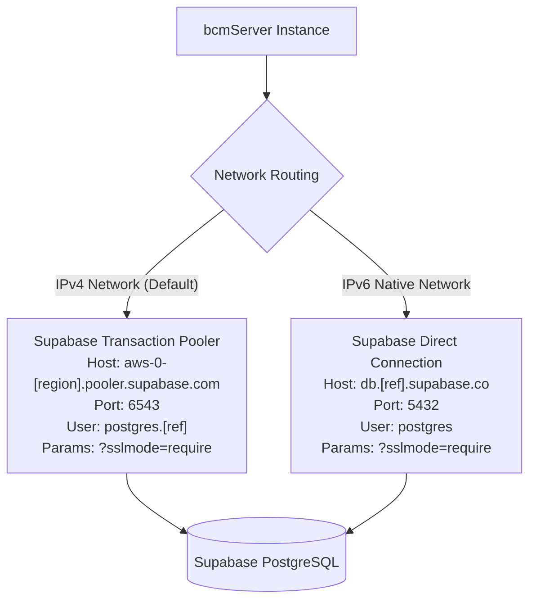

# bcmServer - Operational Runbook

This runbook contains procedures for provisioning, maintaining, diagnosing, and operating **bcmServer** across local and production environments.

---

## 1. Quick Diagnostics Cheat Sheet

| Symptom | Probable Cause | Action |
| :--- | :--- | :--- |
| Server fails to start within 10s | Database unreachable (`DatabaseConnectionVerifier` fail-fast) | Check PostgreSQL container or Supabase connection string and network reachability |
| HTTP 401 on protected route | Missing or expired JWT token | Request a new token via `POST /api/v1/auth/login` and pass in `Authorization: Bearer <token>` |
| HTTP 403 on protected route | Attempting to mutate another user's profile, or account status is `LOCKED`/`INACTIVE` | Verify user ownership in JWT claims or review account status in DB |
| HTTP 429 on auth endpoints | Exceeded 5 requests in 60s window | Wait `Retry-After` seconds or review client IP behind proxy headers |
| Flyway `ValidateException` | Migration file modified after execution | Run `flyway:repair` or inspect checksums in `flyway_schema_history` |

---

## 2. Environment Setup & Execution

### 2.1 Local Docker Setup

1. **Start PostgreSQL 16 container**:
   ```bash
   docker compose up -d
   ```
2. **Verify container health**:
   ```bash
   docker compose ps
   # Container bcmserver-postgres-1 should report 'healthy' or 'running' on port 5432
   ```
3. **Verify `.env` configuration**:
   Ensure `.env` contains:
   ```properties
   SERVER_PORT=8080
   SPRING_PROFILES_ACTIVE=dev
   DB_HOST=localhost
   DB_PORT=5432
   DB_NAME=bcm_db
   DB_USERNAME=postgres
   DB_PASSWORD=postgres
   ```
4. **Boot the server**:
   ```bash
   # Linux / macOS
   ./mvnw spring-boot:run

   # Windows
   .\mvnw.cmd spring-boot:run
   ```

---

### 2.2 Connecting to Supabase

Supabase instances require specific configurations depending on your hosting provider and IP routing:



#### Supabase Configuration (`.env`)
```properties
# Recommended for IPv4 environments (AWS, Azure, DigitalOcean, local machines)
DB_HOST=aws-0-eu-central-1.pooler.supabase.com
DB_PORT=6543
DB_NAME=postgres
DB_USERNAME=postgres.ccthgmjmkdxhpqovbbvk
DB_PASSWORD=[YOUR_SUPABASE_PASSWORD]
DB_QUERY_PARAMS=?sslmode=require
```

> [!IMPORTANT]
> The direct host `db.[ref].supabase.co` on port `5432` only resolves via IPv6. If your application server does not support IPv6 routing, always connect via the pooler on port `6543`.

---

## 3. Database Migrations (Flyway)

### 3.1 Migration File Conventions
Migrations are stored in `src/main/resources/db/migration/`:
- `V1__create_users_table.sql`
- `V2__create_teams_table.sql`
- `V3__create_players_table.sql`
- `V4__create_games_table.sql`
- `V5__create_player_stats_table.sql`
- `V6__add_user_status.sql`

All scripts execute automatically during Spring Boot application startup when `spring.flyway.enabled=true`.

### 3.2 Troubleshooting Flyway Checksum Errors
If a migration script was altered after being applied:
1. Revert any local edits to previously applied migration files.
2. If schema changes are needed, **never edit existing migration files**. Create a new version (e.g. `V7__your_new_change.sql`).
3. If an existing script checksum was accidentally invalidated in staging:
   ```bash
   # Connect to PostgreSQL and inspect history
   SELECT installed_rank, version, description, checksum, success FROM flyway_schema_history;
   ```

---

## 4. Security & JWT Key Rotation

The JWT secret is controlled via `JWT_SECRET` in environment variables:
```properties
# Minimum 256-bit (32 bytes / 64 hex characters)
JWT_SECRET=404E635266556A586E3272357538782F413F4428472B4B6250645367566B5970
JWT_EXPIRATION_MS=86400000 # 24 hours
```

### Rotating Secrets Safely:
1. To rotate keys in production without invalidating all active sessions instantly, schedule rotation during low-traffic windows.
2. Update the environment variable `JWT_SECRET` in your orchestrator (Docker Compose, Kubernetes, AWS ECS, or Cloud Run).
3. Restart instances using rolling updates.
4. Users with tokens signed by the old key will receive HTTP `401 Unauthorized` and must re-authenticate via `/api/v1/auth/login`.

---

## 5. Health Checks & Monitoring

The service exposes Spring Boot Actuator endpoints:

### Liveness & Readiness Probe
```bash
curl -i http://localhost:8080/actuator/health
```

Expected response (`HTTP 200 OK`):
```json
{
  "status": "UP",
  "components": {
    "db": {
      "status": "UP",
      "details": {
        "database": "PostgreSQL",
        "validationQuery": "isValid()"
      }
    },
    "diskSpace": {
      "status": "UP"
    },
    "ping": {
      "status": "UP"
    }
  }
}
```

If PostgreSQL becomes unreachable while the server is running, the `db` status transitions to `DOWN` with HTTP `503 Service Unavailable`.

---

## 6. Incident Triage & Recovery

### Incident 1: Startup Crashes with `IllegalStateException: Database connectivity verification failed`
1. Check the logs for the exact error message emitted by `DatabaseConnectionVerifier`.
2. Test network connectivity from the host:
   ```bash
   # Test port reachability
   nc -zv $DB_HOST $DB_PORT
   # Or on Windows PowerShell:
   Test-NetConnection -ComputerName $DB_HOST -Port $DB_PORT
   ```
3. Verify database credentials in `.env` or container environment.

### Incident 2: High Rate of HTTP 429 Errors
1. Check if requests originate from a reverse proxy or load balancer without forwarded headers (`X-Forwarded-For`).
2. Adjust rate limit thresholds in `application.yml` or via environment variables if legitimate traffic is being throttled:
   ```properties
   RATE_LIMIT_REGISTRATION_MAX=20
   RATE_LIMIT_REGISTRATION_WINDOW=60
   RATE_LIMIT_LOGIN_MAX=20
   RATE_LIMIT_LOGIN_WINDOW=60
   ```

