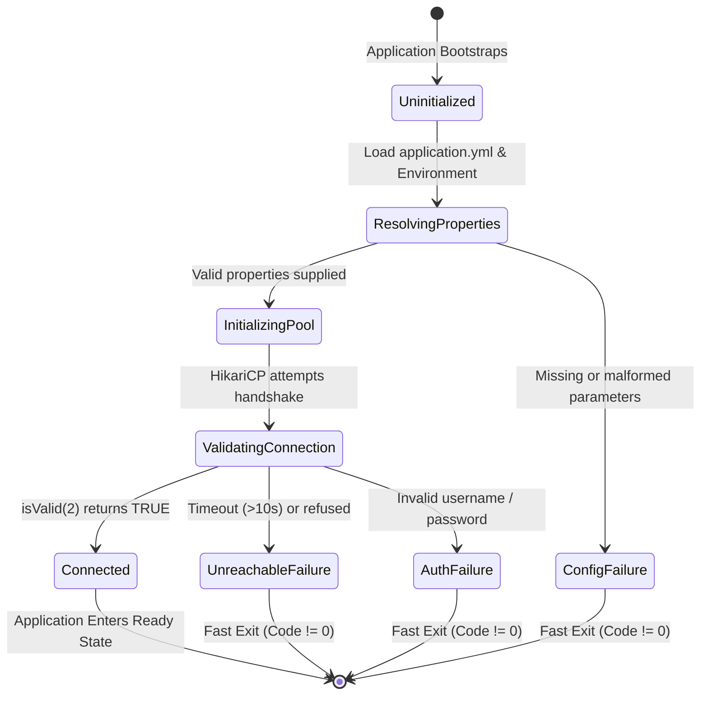
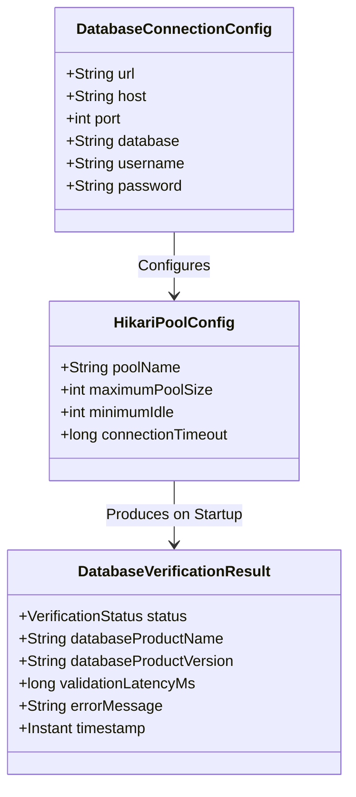

# Data Model & Configuration Entities: Setup BCMServer Project

**Feature**: `001-setup-bcmserver-project`  
**Date**: 2026-10-29  
**Status**: Completed  

---

## 1. Overview & Scope

In accordance with Feature Specification `001-setup-bcmserver-project` and the bcmServer Constitution:
- **No business domain entities or database tables** are mutated or created in this setup feature.
- Persistence framework schema management is configured in passive mode (`ddl-auto: none`).
- The data models for this feature represent the **Configuration Entities**, **Connection Pool Parameters**, and **Startup Verification State** that manage and validate PostgreSQL connectivity.

---

## 2. Configuration & Runtime Entities

### 2.1 Database Connection Configuration (`DatabaseConnectionConfig`)

Represents the externalized environment parameters resolved at application startup to establish database connectivity.

| Field Name | Type | Source / Env Variable | Default / Example | Validation Rules | Description |
| :--- | :--- | :--- | :--- | :--- | :--- |
| `url` | `String` | `DB_URL` or derived from host/port/db | `jdbc:postgresql://localhost:5432/bcm_db` | Must be valid JDBC URL starting with `jdbc:postgresql://` | Full JDBC connection URI |
| `host` | `String` | `DB_HOST` | `localhost` | Non-empty hostname or IP | PostgreSQL host |
| `port` | `Integer` | `DB_PORT` | `5432` | 1-65535 | PostgreSQL network port |
| `database` | `String` | `DB_NAME` | `bcm_db` | Non-empty alphanumeric/underscore | Target database catalog |
| `username` | `String` | `DB_USERNAME` | `postgres` | Non-empty | Database role / authentication identity |
| `password` | `String` | `DB_PASSWORD` | `postgres` | Non-null | Database authentication secret |
| `driverClassName` | `String` | (Internal) | `org.postgresql.Driver` | Class must exist on classpath | JDBC driver class |

---

### 2.2 Connection Pool Configuration (`HikariPoolConfig`)

Defines runtime parameters governing the HikariCP connection pool lifecycle and fail-fast constraints.

| Parameter | Type | Default Value | Unit | Purpose / Constraint |
| :--- | :--- | :--- | :--- | :--- |
| `poolName` | `String` | `BcmHikariPool` | - | Identifies connection threads in diagnostic logs |
| `maximumPoolSize` | `Integer` | `10` | Connections | Maximum concurrent connections to PostgreSQL |
| `minimumIdle` | `Integer` | `2` | Connections | Minimum idle connections kept warm |
| `connectionTimeout` | `Long` | `10000` | Milliseconds | **Fail-fast constraint**: Fail within 10s if DB unreachable (per spec SC-004) |
| `idleTimeout` | `Long` | `300000` | Milliseconds | 5 minutes idle threshold before retirement |
| `maxLifetime` | `Long` | `1800000` | Milliseconds | 30 minutes connection rotation |

---

### 2.3 Startup Verification State (`DatabaseVerificationResult`)

Captures the diagnostic telemetry emitted during the bootstrap database verification phase.

| Field Name | Type | Example Value | Description |
| :--- | :--- | :--- | :--- |
| `status` | `VerificationStatus` | `CONNECTED` or `FAILED` | Connection state enum (`CONNECTED`, `FAILED`, `UNREACHABLE`) |
| `databaseProductName`| `String` | `PostgreSQL` | Retrieved via `DatabaseMetaData.getDatabaseProductName()` |
| `databaseProductVersion` | `String` | `16.4` | Retrieved via `DatabaseMetaData.getDatabaseProductVersion()` |
| `validationLatencyMs` | `Long` | `15` | Roundtrip latency of `isValid(2)` check |
| `errorMessage` | `String` | `Connection refused to localhost:5432` | Diagnostic failure message when status is `FAILED` |
| `timestamp` | `Instant` | `2026-10-29T14:00:00Z` | Verification execution timestamp |

---

## 3. Entity State Transitions

### Database Connection Verification Lifecycle

---

## 4. Relationship to Domain Models

*Note: Future features will introduce relational domain models (`User`, `Team`, `Player`, `Game`, `PlayerStats`) mapped against the database schema specified in `docs/data_models.md`.*

