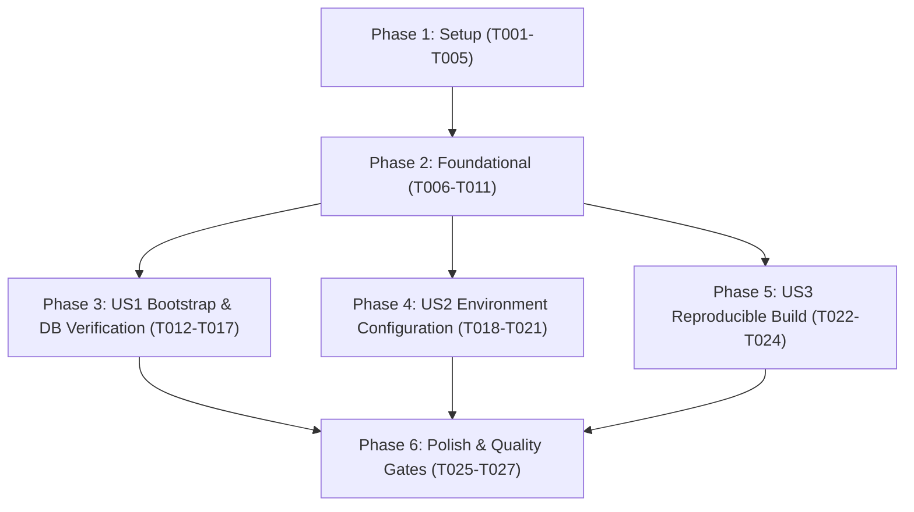

# Tasks: Setup BCMServer Project

**Input**: Design documents from `/specs/001-setup-bcmserver-project/`  
**Prerequisites**: `plan.md` (required), `spec.md` (required for user stories), `research.md`, `data-model.md`, `contracts/`, `quickstart.md`, `.specify/memory/constitution.md`

## Format: `- [ ] [ID] [P?] [Story] Description with file path`

- **[P]**: Can run in parallel (different files, no dependencies on incomplete tasks)
- **[Story]**: Which user story this task belongs to (`[US1]`, `[US2]`, `[US3]`)
- Every task includes explicit file paths

---

## Phase 1: Setup (Shared Infrastructure)

**Purpose**: Project initialization, build descriptor, and local environment infrastructure

- [X] T001 Initialize Maven build configuration with Java 21 and Spring Boot 3.4.x dependencies in pom.xml
- [X] T002 [P] Configure Maven Wrapper scripts in mvnw, mvnw.cmd, and .mvn/wrapper/maven-wrapper.properties
- [X] T003 [P] Create Hexagonal Architecture directory layout per implementation plan across src/main/java/com/basketapp/bcmserver/
- [X] T004 [P] Create local PostgreSQL 16 container service configuration with healthcheck in docker-compose.yml
- [X] T005 [P] Configure repository version control ignore rules for build artifacts and local secrets in .gitignore

---

## Phase 2: Foundational (Blocking Prerequisites)

**Purpose**: Core application entry point, baseline configuration, and test harness that MUST be complete before ANY user story can be implemented

**⚠️ CRITICAL**: No user story work can begin until this phase is complete

- [X] T006 Create base application configuration file with logging and actuator endpoints in src/main/resources/application.yml
- [X] T007 [P] Create development environment profile configuration in src/main/resources/application-dev.yml
- [X] T008 [P] Create test environment profile configuration in src/test/resources/application-test.yml
- [X] T009 Create Spring Boot entry point class in src/main/java/com/basketapp/bcmserver/BcmServerApplication.java
- [X] T010 [P] Create Springdoc OpenAPI baseline configuration in src/main/java/com/basketapp/bcmserver/infrastructure/config/OpenApiConfig.java
- [X] T011 Create base application context load verification test in src/test/java/com/basketapp/bcmserver/BcmServerApplicationTests.java

**Checkpoint**: Foundation ready - Spring Boot context initializes cleanly and testing harness is verified.

---

## Phase 3: User Story 1 - Server Bootstrap and Database Verification (Priority: P1) 🎯 MVP

**Goal**: Start the backend application and automatically verify that it establishes a live connection to PostgreSQL without mutating data or generating tables, failing fast within 10 seconds if unreachable.

**Independent Test**: Start application with PostgreSQL running (`docker compose up -d`), verify console logs emit structured connectivity verification details, confirm `GET /actuator/health` returns HTTP 200 with `db: UP`, and verify cold-start completes in < 15 seconds with no tables modified (`ddl-auto: none`).

### Tests for User Story 1 ⚠️

- [X] T012 [P] [US1] Create unit and mock tests for database connection verification in src/test/java/com/basketapp/bcmserver/infrastructure/config/DatabaseConnectionVerifierTest.java
- [X] T013 [P] [US1] Create integration test verifying fail-fast shutdown on unreachable database in src/test/java/com/basketapp/bcmserver/infrastructure/config/DatabaseFailFastIntegrationTest.java

### Implementation for User Story 1

- [X] T014 [P] [US1] Create connection status enum and verification result model in src/main/java/com/basketapp/bcmserver/infrastructure/config/VerificationStatus.java and src/main/java/com/basketapp/bcmserver/infrastructure/config/DatabaseVerificationResult.java
- [X] T015 [US1] Implement DatabaseConnectionVerifier ApplicationRunner for cold-start database validation in src/main/java/com/basketapp/bcmserver/infrastructure/config/DatabaseConnectionVerifier.java
- [X] T016 [US1] Configure HikariCP connection pool settings with 10s connection timeout and passive ddl-auto mode in src/main/resources/application.yml
- [X] T017 [US1] Configure Spring Boot Actuator health endpoint and database health indicator in src/main/resources/application.yml

**Checkpoint**: User Story 1 is functional and verifiable independently. Cold-start connectivity check and fail-fast behavior are operational.

---

## Phase 4: User Story 2 - Environment-Isolated Database Configuration (Priority: P2)

**Goal**: Ensure all database connection parameters and credentials are externalized into environment variables with a template file provided, guaranteeing zero hardcoded secrets.

**Independent Test**: Review `.env.example` against `environment-contract.md`, launch the application with customized environment variables (`DB_HOST`, `DB_PORT`, `DB_NAME`, `DB_USERNAME`, `DB_PASSWORD`, `DB_URL`), and verify values are dynamically bound to HikariCP.

### Tests for User Story 2 ⚠️

- [X] T018 [P] [US2] Create environment configuration property binding test in src/test/java/com/basketapp/bcmserver/infrastructure/config/EnvironmentConfigurationTest.java

### Implementation for User Story 2

- [X] T019 [P] [US2] Create environment variables template file per environment-contract.md in .env.example
- [X] T020 [US2] Configure environment variable interpolation and fallback defaults for datasource in src/main/resources/application.yml
- [X] T021 [US2] Configure dev profile datasource overrides with environment variable support in src/main/resources/application-dev.yml

**Checkpoint**: User Stories 1 and 2 operate together. Credentials are fully isolated and configurable per environment.

---

## Phase 5: User Story 3 - Reproducible Project Build and Dependency Resolution (Priority: P3)

**Goal**: Ensure clean Maven project configuration targeting Java 21 and Spring Boot 3, building and packaging deterministically across machines and pipelines.

**Independent Test**: Execute `./mvnw clean compile` and `./mvnw clean package -DskipTests` to verify exit code 0, zero warnings, and correct bytecode target.

### Implementation for User Story 3

- [X] T022 [US3] Configure Maven compiler plugin with Java 21 source/target and compiler warnings flags in pom.xml
- [X] T023 [US3] Configure Spring Boot Maven plugin with repackaging and layering execution in pom.xml
- [X] T024 [US3] Verify Maven Wrapper executable permissions and wrapper properties in .mvn/wrapper/maven-wrapper.properties

**Checkpoint**: All three user stories are complete. Build, configuration, and runtime verification are fully operational.

---

## Phase 6: Polish & Cross-Cutting Concerns

**Purpose**: Validation, formatting, and end-to-end sanity checks across all deliverables

- [X] T025 [P] Verify documentation links and markdown formatting in docs/ and specs/001-setup-bcmserver-project/
- [X] T026 Execute end-to-end quickstart scenarios from specs/001-setup-bcmserver-project/quickstart.md against local PostgreSQL container
- [X] T027 Validate compliance with bcmServer Constitution architectural quality gates

---

## Dependencies & Execution Order

### Phase Dependencies



- **Setup (Phase 1)**: No dependencies - can start immediately.
- **Foundational (Phase 2)**: Depends on Phase 1 completion - BLOCKS all user stories.
- **User Stories (Phases 3, 4, 5)**: Depend on Phase 2 completion.
  - Can proceed sequentially in priority order (P1 → P2 → P3) or in parallel by separate developers.
- **Polish (Phase 6)**: Depends on all user stories being completed.

### User Story Dependencies

- **User Story 1 (P1)**: Depends only on Foundational Phase (Phase 2). Establishes the database verification runner and fail-fast connectivity.
- **User Story 2 (P2)**: Depends on Foundational Phase (Phase 2). Integrates with `application.yml` datasource settings established in US1.
- **User Story 3 (P3)**: Depends on Foundational Phase (Phase 2). Finalizes build plugin configurations and wrapper execution.

### Within Each User Story

- Test specifications written and executed first (ensuring test coverage).
- Models/enums created before services and configuration runners.
- Core configuration before environmental overrides.
- Story complete and validated before moving to next priority.

### Parallel Opportunities

- **Phase 1 (Setup)**: `T002`, `T003`, `T004`, `T005` can all run in parallel once `T001` starts.
- **Phase 2 (Foundational)**: `T007`, `T008`, `T010` can run in parallel while `T006` and `T009` are prepared.
- **Phase 3 (US1)**: `T012` and `T013` (tests) can run in parallel; `T014` can run in parallel with tests.
- **Phase 4 (US2)**: `T018` and `T019` can run in parallel.
- **Phase 6 (Polish)**: `T025` can run in parallel with scenario executions.

---

## Parallel Execution Examples

### Parallel Example: Phase 1 (Setup)
```bash
# Parallel setup execution:
Task: "Configure Maven Wrapper scripts in mvnw, mvnw.cmd, and .mvn/wrapper/maven-wrapper.properties" (T002)
Task: "Create Hexagonal Architecture directory layout per implementation plan across src/main/java/com/basketapp/bcmserver/" (T003)
Task: "Create local PostgreSQL 16 container service configuration with healthcheck in docker-compose.yml" (T004)
Task: "Configure repository version control ignore rules for build artifacts and local secrets in .gitignore" (T005)
```

### Parallel Example: User Story 1 (P1)
```bash
# Parallel tests and models for US1:
Task: "Create unit and mock tests for database connection verification in src/test/java/com/basketapp/bcmserver/infrastructure/config/DatabaseConnectionVerifierTest.java" (T012)
Task: "Create integration test verifying fail-fast shutdown on unreachable database in src/test/java/com/basketapp/bcmserver/infrastructure/config/DatabaseFailFastIntegrationTest.java" (T013)
Task: "Create connection status enum and verification result model in src/main/java/com/basketapp/bcmserver/infrastructure/config/VerificationStatus.java and src/main/java/com/basketapp/bcmserver/infrastructure/config/DatabaseVerificationResult.java" (T014)
```

### Parallel Example: User Story 2 (P2)
```bash
# Parallel tasks for US2:
Task: "Create environment configuration property binding test in src/test/java/com/basketapp/bcmserver/infrastructure/config/EnvironmentConfigurationTest.java" (T018)
Task: "Create environment variables template file per environment-contract.md in .env.example" (T019)
```

---

## Implementation Strategy

### MVP First (User Story 1 Only)

1. Complete Phase 1: Setup (`T001`-`T005`).
2. Complete Phase 2: Foundational (`T006`-`T011`).
3. Complete Phase 3: User Story 1 (`T012`-`T017`).
4. **STOP and VALIDATE**:
   - Start local PostgreSQL: `docker compose up -d`
   - Run server: `./mvnw spring-boot:run`
   - Verify health endpoint: `curl http://localhost:8080/actuator/health`
   - Verify passive DDL mode: no tables generated in PostgreSQL.
   - Stop PostgreSQL: verify server fails fast within 10 seconds.
5. Deliver/demonstrate MVP.

### Incremental Delivery

1. **Increment 1**: Complete Phase 1 & 2 -> Application compiles and context boots.
2. **Increment 2 (MVP)**: Deliver User Story 1 -> Verified cold-start database connection and fail-fast behavior.
3. **Increment 3**: Deliver User Story 2 -> Environment template (`.env.example`) and full runtime variable overrides.
4. **Increment 4**: Deliver User Story 3 -> Hardened compiler rules, reproducible packaging, and wrapper validation.
5. **Increment 5**: Complete Phase 6 Polish -> Validate against Constitution and quickstart scenarios.

