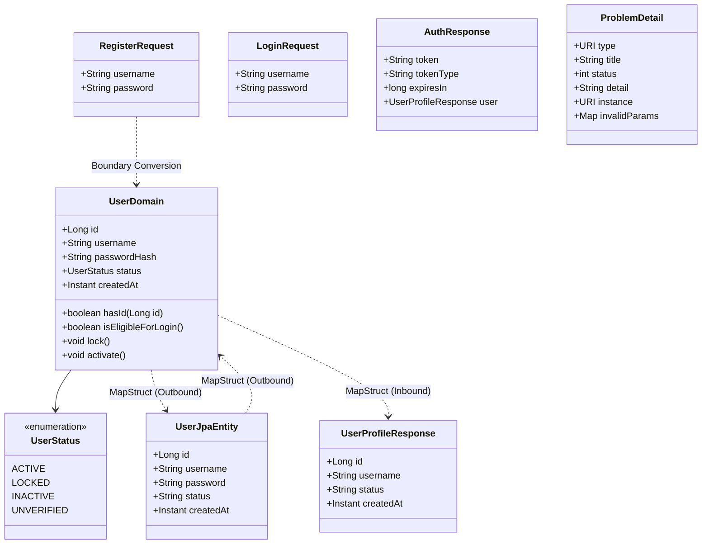
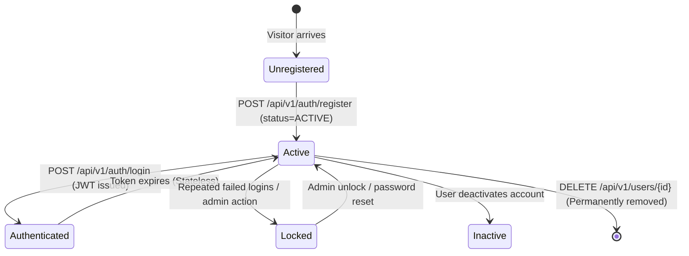

# Data Model & Schema Contracts: Users Endpoints

**Feature Branch**: `002-users-endpoints-contracts`  
**Date**: 2026-11-01  
**Status**: Completed  

---

## 1. Relational Database Schema (`users` table)

Conforms directly to `docs/data_models.md` and Flyway migrations `V1__create_users_table.sql` and `V2__add_user_status.sql`.

### Table: `users`

| Column | PostgreSQL Type | Nullable | Default | Constraints & Description |
| :--- | :--- | :--- | :--- | :--- |
| `id` | `BIGSERIAL` / `SERIAL` | `NOT NULL` | Auto-increment | Primary Key (`PK_users_id`) |
| `username` | `VARCHAR(50)` | `NOT NULL` | None | Unique constraint (`UQ_users_username`), indexed |
| `password` | `TEXT` | `NOT NULL` | None | Stored BCrypt password hash (never raw plain text) |
| `status` | `VARCHAR(20)` | `NOT NULL` | `'ACTIVE'` | Account status (`ACTIVE`, `LOCKED`, `INACTIVE`, `UNVERIFIED`) |
| `created_at` | `TIMESTAMPTZ` | `NOT NULL` | `CURRENT_TIMESTAMP` | Account creation timestamp in UTC |

### Database Indexes

- `PK_users_id`: Primary key index on `id`.
- `idx_users_username`: Unique B-Tree index on `username` for O(1) lookup and uniqueness enforcement.
- `idx_users_status`: B-Tree index on `status` for fast status filtering.

---

## 2. Multi-Layer Entity Separation (Hexagonal Architecture)

Per Constitution Principle I, entities are isolated into three distinct tiers: Domain Model, Persistence Entity, and Data Transfer Objects (DTOs).

---

## 3. Domain Model Specifications

### `com.basketapp.bcmserver.domain.model.User`
- **Package**: `com.basketapp.bcmserver.domain.model`
- **Characteristics**: Pure Java 21 class with no framework dependencies (`javax.*`, `jakarta.*`, `org.springframework.*`, `org.hibernate.*`).
- **Attributes**:
  - `id`: `Long` (nullable before persistence, non-null once persisted)
  - `username`: `String` (validated, non-empty, unique)
  - `passwordHash`: `String` (hashed representation; named `passwordHash` in domain to make hashing requirement explicit)
  - `status`: `UserStatus` (account lifecycle state)
  - `createdAt`: `Instant` (UTC timestamp)
- **Domain Methods**:
  - `create(String username, String passwordHash)`: Factory for initial registration (defaults status to `UserStatus.ACTIVE`).
  - `reconstitute(Long id, String username, String passwordHash, UserStatus status, Instant createdAt)`: Reconstitutes an existing persisted record.
  - `isEligibleForLogin()`: Returns `true` if `status == UserStatus.ACTIVE`.
  - `updateUsername(String newUsername)`: Validates and updates username.
  - `updatePasswordHash(String newPasswordHash)`: Validates and updates password hash.

---

## 4. Persistence Entity Specifications

### `com.basketapp.bcmserver.infrastructure.adapter.out.persistence.UserJpaEntity`
- **Package**: `com.basketapp.bcmserver.infrastructure.adapter.out.persistence`
- **Annotations**: `@Entity`, `@Table(name = "users")`
- **Attributes**:
  - `@Id @GeneratedValue(strategy = GenerationType.IDENTITY) private Long id;`
  - `@Column(name = "username", nullable = false, unique = true) private String username;`
  - `@Column(name = "password", nullable = false) private String password;`
  - `@Column(name = "status", nullable = false) private String status;`
  - `@Column(name = "created_at", nullable = false, updatable = false) private Instant createdAt;`
- **Lifecycle Hook**:
  - `@PrePersist protected void onCreate() { if (createdAt == null) createdAt = Instant.now(); if (status == null) status = "ACTIVE"; }`

---

## 5. Web DTOs & Boundary Validation Rules

All requests are validated using `jakarta.validation.constraints` annotations at the controller boundary.

### 5.1. `RegisterRequest`
Input payload for `POST /api/v1/auth/register`.

| Field | Type | Validation Rules | Description |
| :--- | :--- | :--- | :--- |
| `username` | `String` | `@NotBlank`, `@Size(min = 3, max = 50)`, `@Pattern(regexp = "^[a-zA-Z0-9_.-]+$")` | Unique desired username |
| `password` | `String` | `@NotBlank`, `@Size(min = 8, max = 100)` | Plaintext password to hash |

### 5.2. `LoginRequest`
Input payload for `POST /api/v1/auth/login`.

| Field | Type | Validation Rules | Description |
| :--- | :--- | :--- | :--- |
| `username` | `String` | `@NotBlank` | Registered username |
| `password` | `String` | `@NotBlank` | Plaintext password |

### 5.3. `UpdateUserRequest`
Input payload for `PUT /api/v1/users/{id}`.

| Field | Type | Validation Rules | Description |
| :--- | :--- | :--- | :--- |
| `username` | `String` | Optional; if present: `@Size(min = 3, max = 50)`, `@Pattern(regexp = "^[a-zA-Z0-9_.-]+$")` | New username |
| `password` | `String` | Optional; if present: `@Size(min = 8, max = 100)` | New password to hash |

### 5.4. `UserProfileResponse`
Public response payload for profile queries (`GET /api/v1/users/{id}`, `GET /api/v1/users/me`, `POST /api/v1/auth/register`, `PUT /api/v1/users/{id}`).

| Field | Type | Nullable | Description |
| :--- | :--- | :--- | :--- |
| `id` | `Long` | `false` | System unique user identifier |
| `username` | `String` | `false` | Registered unique username |
| `status` | `String` | `false` | Account status (`ACTIVE`, `LOCKED`, etc.) |
| `createdAt` | `Instant` | `false` | Registration timestamp |

> [!IMPORTANT]
> The `password` / `passwordHash` field is strictly excluded from `UserProfileResponse` at both compile time and runtime via MapStruct configuration (`@Mapping(target = "password", ignore = true)`).

### 5.5. `AuthResponse`
Response payload for successful authentication (`POST /api/v1/auth/login`).

| Field | Type | Description |
| :--- | :--- | :--- |
| `token` | `String` | Signed JWT bearer token string |
| `tokenType` | `String` | Fixed string `"Bearer"` |
| `expiresIn` | `long` | Token validity duration in seconds (e.g. 3600) |
| `user` | `UserProfileResponse` | Associated user profile details |

### 5.6. `ProblemDetail` (RFC 7807 Error Response)

| Field | Type | Description | Example |
| :--- | :--- | :--- | :--- |
| `type` | `URI` | URI reference identifying the error type | `"https://api.basketapp.com/errors/validation-error"` |
| `title` | `String` | Short summary of problem | `"Bad Request"` |
| `status` | `int` | HTTP status code | `400`, `401`, `403`, `409`, `422`, `429`, `500` |
| `detail` | `String` | Human-readable explanation of occurrence | `"Validation failed for request payload"` |
| `instance` | `URI` | URI of the request endpoint | `"/api/v1/auth/register"` |
| `invalidParams` | `Map<String, String>` | Field-specific validation failures (optional) | `{"password": "Password must be at least 8 characters"}` |

---

## 6. Entity State Lifecycle & Transitions

