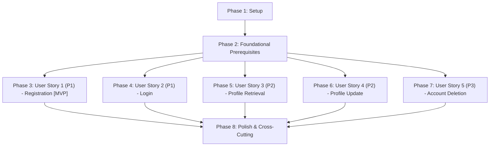

# Tasks: Users Endpoints & Contracts

**Input**: Design documents from `specs/002-users-endpoints-contracts/`  
**Prerequisites**: [plan.md](file:///j:/GitHub/BasketApp/bcmServer/specs/002-users-endpoints-contracts/plan.md), [spec.md](file:///j:/GitHub/BasketApp/bcmServer/specs/002-users-endpoints-contracts/spec.md), [research.md](file:///j:/GitHub/BasketApp/bcmServer/specs/002-users-endpoints-contracts/research.md), [data-model.md](file:///j:/GitHub/BasketApp/bcmServer/specs/002-users-endpoints-contracts/data-model.md), [contracts/](file:///j:/GitHub/BasketApp/bcmServer/specs/002-users-endpoints-contracts/contracts/), [quickstart.md](file:///j:/GitHub/BasketApp/bcmServer/specs/002-users-endpoints-contracts/quickstart.md)  
**Tests**: Automated tests included per Constitution Principle V (Automated Testing & Quality Verification).  
**Organization**: Tasks are grouped by user story to enable independent implementation and testing of each story.

## Format: `[ID] [P?] [Story] Description`

- **[P]**: Can run in parallel (different files, no dependencies on incomplete tasks)
- **[Story]**: Which user story this task belongs to (e.g., `[US1]`, `[US2]`, `[US3]`, `[US4]`, `[US5]`)
- File paths are exact and grounded in the `bcmServer` project structure

---

## Phase 1: Setup (Shared Infrastructure)

**Purpose**: Project build configuration, shared dependencies, and database migrations.

- [X] T001 Update Maven dependencies in pom.xml for Spring Security, JJWT 0.12.6, MapStruct 1.6.3, Flyway PostgreSQL, and spring-security-test
- [X] T002 [P] Configure Flyway migrations, Hibernate validation, and JWT secret settings in src/main/resources/application.yml and src/main/resources/application-dev.yml
- [X] T003 [P] Create Flyway migration V6__add_user_status.sql adding status column and idx_users_status index in src/main/resources/db/migration/V6__add_user_status.sql

---

## Phase 2: Foundational (Blocking Prerequisites)

**Purpose**: Core domain abstractions, security adapters, persistence infrastructure, rate limiter, and error handlers that MUST be complete before ANY user story can be implemented.

**⚠️ CRITICAL**: No user story work can begin until this phase is complete.

- [X] T004 Create domain exception hierarchy (DomainException, UserAlreadyExistsException, UserNotFoundException, InvalidCredentialsException, UnauthorizedOperationException, AccountStatusException, SemanticValidationException, RateLimitExceededException) in src/main/java/com/basketapp/bcmserver/domain/exception/DomainException.java
- [X] T005 [P] Create UserStatus enum (ACTIVE, LOCKED, INACTIVE, UNVERIFIED) in src/main/java/com/basketapp/bcmserver/domain/model/UserStatus.java
- [X] T006 [P] Implement pure Java 21 User domain entity with invariants, status evaluation, and factory methods in src/main/java/com/basketapp/bcmserver/domain/model/User.java
- [X] T007 [P] Define UserRepositoryPort interface in src/main/java/com/basketapp/bcmserver/application/port/out/UserRepositoryPort.java
- [X] T008 [P] Define PasswordEncoderPort interface in src/main/java/com/basketapp/bcmserver/application/port/out/PasswordEncoderPort.java
- [X] T009 [P] Define TokenProviderPort interface in src/main/java/com/basketapp/bcmserver/application/port/out/TokenProviderPort.java
- [X] T010 [P] Define RateLimiterPort interface for throttling requests in src/main/java/com/basketapp/bcmserver/application/port/out/RateLimiterPort.java
- [X] T011 [P] Create AuthToken value object in src/main/java/com/basketapp/bcmserver/application/port/in/AuthToken.java
- [X] T012 [P] Implement BCryptPasswordEncoderAdapter in src/main/java/com/basketapp/bcmserver/infrastructure/adapter/out/security/BCryptPasswordEncoderAdapter.java
- [X] T013 [P] Implement JwtTokenAdapter for JWT generation, validation, and claim parsing in src/main/java/com/basketapp/bcmserver/infrastructure/adapter/out/security/JwtTokenAdapter.java
- [X] T014 [P] Implement InMemoryRateLimiterAdapter with sliding window algorithm in src/main/java/com/basketapp/bcmserver/infrastructure/adapter/out/ratelimit/InMemoryRateLimiterAdapter.java
- [X] T015 [P] Create JPA entity UserJpaEntity with status field and lifecycle hooks in src/main/java/com/basketapp/bcmserver/infrastructure/adapter/out/persistence/UserJpaEntity.java
- [X] T016 Create SpringDataJpaUserRepository in src/main/java/com/basketapp/bcmserver/infrastructure/adapter/out/persistence/SpringDataJpaUserRepository.java
- [X] T017 [P] Create MapStruct mapper UserPersistenceMapper in src/main/java/com/basketapp/bcmserver/infrastructure/adapter/out/persistence/mapper/UserPersistenceMapper.java
- [X] T018 Implement UserRepositoryAdapter connecting UserRepositoryPort to SpringDataJpaUserRepository in src/main/java/com/basketapp/bcmserver/infrastructure/adapter/out/persistence/UserRepositoryAdapter.java
- [X] T019 [P] Implement GlobalExceptionHandler with RFC 7807 ProblemDetail mappings for 400, 401, 403, 409, 422, 429, and 500 status codes in src/main/java/com/basketapp/bcmserver/infrastructure/adapter/in/web/exception/GlobalExceptionHandler.java
- [X] T020 [P] Implement RateLimitingFilter intercepting auth routes to enforce rate limits and append Retry-After headers in src/main/java/com/basketapp/bcmserver/infrastructure/adapter/in/web/filter/RateLimitingFilter.java
- [X] T021 Implement stateless JwtAuthenticationFilter in src/main/java/com/basketapp/bcmserver/infrastructure/config/JwtAuthenticationFilter.java
- [X] T022 Implement SecurityConfig with stateless session policy, rate limit filter, and authorization rules in src/main/java/com/basketapp/bcmserver/infrastructure/config/SecurityConfig.java

**Checkpoint**: Core foundation ready - user story implementation can now begin.

---

## Phase 3: User Story 1 - Public User Registration with Comprehensive Validation and Error Handling (Priority: P1) 🎯 MVP

**Goal**: Enable new visitors to register with a unique username and password. Validates input format at boundary, returns 400 Bad Request for malformed/missing fields, cryptographically hashes password with salt before persistence, prevents duplicate usernames with 409 Conflict, enforces semantic password complexity with 422 Unprocessable Entity, enforces rate limiting with 429 Too Many Requests, captures unexpected system errors with 500 Internal Server Error, and returns created user profile strictly omitting the password.

**Independent Test**: Send valid registration request to `POST /api/v1/auth/register` and verify 201 Created with user JSON without password, and verified hashed password in database. Send invalid payloads (<3 char username, empty password) and verify 400 Bad Request with Problem Details without persistence writes. Send duplicate username and verify 409 Conflict. Send weak password violating semantic complexity rules and verify 422 Unprocessable Entity. Send rapid burst of registrations exceeding threshold and verify 429 Too Many Requests with Retry-After header. Verify unhandled server failures return 500 Internal Server Error without leaking stack traces.

### Tests for User Story 1 ⚠️

> **NOTE: Write these tests FIRST, ensure they FAIL before implementation**

- [X] T023 [P] [US1] Create unit tests for User domain entity invariants and status defaults in src/test/java/com/basketapp/bcmserver/domain/UserTest.java
- [X] T024 [P] [US1] Create unit tests for user registration handling (success, collision, semantic password validation) in UserServiceTest in src/test/java/com/basketapp/bcmserver/application/UserServiceTest.java
- [X] T025 [P] [US1] Create web slice tests for POST /api/v1/auth/register covering 201 Created, 400 Bad Request, 409 Conflict, 422 Unprocessable Entity, 429 Too Many Requests, and 500 Internal Server Error in src/test/java/com/basketapp/bcmserver/infrastructure/adapter/in/web/AuthControllerTest.java

### Implementation for User Story 1

- [X] T026 [P] [US1] Create RegisterUserCommand and RegisterUserUseCase in src/main/java/com/basketapp/bcmserver/application/port/in/RegisterUserUseCase.java
- [X] T027 [P] [US1] Create RegisterRequest and UserProfileResponse DTOs with validation annotations in src/main/java/com/basketapp/bcmserver/infrastructure/adapter/in/web/dto/RegisterRequest.java
- [X] T028 [P] [US1] Create UserWebMapper MapStruct interface strictly ignoring password in src/main/java/com/basketapp/bcmserver/infrastructure/adapter/in/web/mapper/UserWebMapper.java
- [X] T029 [US1] Implement registration use case with collision checks, password complexity validation, and persistence dispatch in UserService in src/main/java/com/basketapp/bcmserver/application/service/UserService.java
- [X] T030 [US1] Implement AuthController with POST /api/v1/auth/register endpoint in src/main/java/com/basketapp/bcmserver/infrastructure/adapter/in/web/AuthController.java

**Checkpoint**: User Story 1 complete and independently verifiable (MVP scope reached).

---

## Phase 4: User Story 2 - Public Stateless User Authentication (Login) with Resilient Error Handling (Priority: P1)

**Goal**: Enable registered users to authenticate using username and password, receiving a verifiable signed JWT token without server-side session state (`HttpSession` count = 0). Defends against account enumeration with generic 401 Unauthorized messages, evaluates account lifecycle state returning 403 Forbidden for locked/inactive/unverified accounts, throttles brute-force attempts with 429 Too Many Requests, returns 400 Bad Request for missing credentials, and safely intercepts cryptographic token signing or server faults returning 500 Internal Server Error.

**Independent Test**: Submit valid credentials to `POST /api/v1/auth/login` and verify 200 OK returning signed JWT token and user profile. Submit incorrect credentials or non-existent username and verify 401 Unauthorized with generic "Invalid credentials" message. Submit credentials for an account with status LOCKED or INACTIVE and verify 403 Forbidden. Submit empty or missing fields and verify 400 Bad Request. Submit repeated rapid login attempts and verify 429 Too Many Requests with Retry-After header. Verify token signing or internal server failures return 500 Internal Server Error.

### Tests for User Story 2 ⚠️

> **NOTE: Write these tests FIRST, ensure they FAIL before implementation**

- [X] T031 [P] [US2] Create unit tests for user login use case covering valid login, invalid credentials anti-enumeration, account status checks (LOCKED/INACTIVE), and token generation failures in src/test/java/com/basketapp/bcmserver/application/AuthServiceTest.java
- [X] T032 [P] [US2] Add web slice tests for POST /api/v1/auth/login covering 200 OK, 400 Bad Request, 401 Unauthorized, 403 Forbidden, 429 Too Many Requests, and 500 Internal Server Error in src/test/java/com/basketapp/bcmserver/infrastructure/adapter/in/web/AuthControllerTest.java

### Implementation for User Story 2

- [X] T033 [P] [US2] Create LoginUserCommand and LoginUserUseCase in src/main/java/com/basketapp/bcmserver/application/port/in/LoginUserUseCase.java
- [X] T034 [P] [US2] Create LoginRequest and AuthResponse DTOs in src/main/java/com/basketapp/bcmserver/infrastructure/adapter/in/web/dto/LoginRequest.java
- [X] T035 [US2] Implement login use case checking credentials with anti-enumeration timing, evaluating UserStatus, and generating signed JWT tokens in AuthService in src/main/java/com/basketapp/bcmserver/application/service/AuthService.java
- [X] T036 [US2] Add POST /api/v1/auth/login endpoint to AuthController in src/main/java/com/basketapp/bcmserver/infrastructure/adapter/in/web/AuthController.java

**Checkpoint**: User Stories 1 and 2 are fully functional; users can register and login statelessly with comprehensive error handling.

---

## Phase 5: User Story 3 - Authenticated User Profile Retrieval (Priority: P2)

**Goal**: Enable authenticated users to retrieve their profile information (`/api/v1/users/me` and `/api/v1/users/{id}`) presenting a valid JWT bearer token.

**Independent Test**: Present valid JWT bearer token to `GET /api/v1/users/me` and `GET /api/v1/users/{id}`; verify 200 OK with `id`, `username`, `status`, `createdAt` (strictly omitting password). Make requests without token or with invalid token; verify 401 Unauthorized. Request non-existent user ID; verify 404 Not Found with RFC 7807 problem detail.

### Tests for User Story 3 ⚠️

> **NOTE: Write these tests FIRST, ensure they FAIL before implementation**

- [X] T037 [P] [US3] Add unit tests for profile retrieval by ID and username in src/test/java/com/basketapp/bcmserver/application/UserServiceTest.java
- [X] T038 [P] [US3] Create web slice tests for GET /api/v1/users/me and GET /api/v1/users/{id} in src/test/java/com/basketapp/bcmserver/infrastructure/adapter/in/web/UserControllerTest.java

### Implementation for User Story 3

- [X] T039 [P] [US3] Create GetUserProfileUseCase in src/main/java/com/basketapp/bcmserver/application/port/in/GetUserProfileUseCase.java
- [X] T040 [US3] Implement profile retrieval use cases in UserService in src/main/java/com/basketapp/bcmserver/application/service/UserService.java
- [X] T041 [US3] Create UserController with GET /api/v1/users/me and GET /api/v1/users/{id} in src/main/java/com/basketapp/bcmserver/infrastructure/adapter/in/web/UserController.java

**Checkpoint**: Authenticated users can retrieve account details using their JWT token.

---

## Phase 6: User Story 4 - Authenticated User Profile Update (Priority: P2)

**Goal**: Enable authenticated users to update their username and/or password. Validates input format, hashes new passwords before storage, enforces uniqueness on username updates (409 Conflict), and verifies ownership to prevent unauthorized modifications across accounts (403 Forbidden).

**Independent Test**: Send `PUT /api/v1/users/{id}` with valid updated username or password using the owner's token; verify 200 OK and database reflection. Attempt update with duplicate username; verify 409 Conflict. Attempt update on another user's ID; verify 403 Forbidden. Attempt with invalid password length; verify 400 Bad Request.

### Tests for User Story 4 ⚠️

> **NOTE: Write these tests FIRST, ensure they FAIL before implementation**

- [X] T042 [P] [US4] Add unit tests for user profile and password updates with ownership checks in src/test/java/com/basketapp/bcmserver/application/UserServiceTest.java
- [X] T043 [P] [US4] Add web slice tests for PUT /api/v1/users/{id} in src/test/java/com/basketapp/bcmserver/infrastructure/adapter/in/web/UserControllerTest.java

### Implementation for User Story 4

- [X] T044 [P] [US4] Create UpdateUserCommand and UpdateUserProfileUseCase in src/main/java/com/basketapp/bcmserver/application/port/in/UpdateUserProfileUseCase.java
- [X] T045 [P] [US4] Create UpdateUserRequest DTO with validation annotations in src/main/java/com/basketapp/bcmserver/infrastructure/adapter/in/web/dto/UpdateUserRequest.java
- [X] T046 [US4] Implement user update use case with password re-hashing and ownership verification in UserService in src/main/java/com/basketapp/bcmserver/application/service/UserService.java
- [X] T047 [US4] Add PUT /api/v1/users/{id} endpoint to UserController in src/main/java/com/basketapp/bcmserver/infrastructure/adapter/in/web/UserController.java

**Checkpoint**: Authenticated users can safely update credentials and usernames within strict ownership boundaries.

---

## Phase 7: User Story 5 - Authenticated Account Deletion (Priority: P3)

**Goal**: Enable authenticated users to permanently delete their account with self-service ownership enforcement.

**Independent Test**: Send `DELETE /api/v1/users/{id}` with owner's token; verify 204 No Content. Verify record is permanently removed from the database and subsequent login or retrieval fails. Attempt deletion of another user's ID; verify 403 Forbidden. Attempt deletion without token; verify 401 Unauthorized.

### Tests for User Story 5 ⚠️

> **NOTE: Write these tests FIRST, ensure they FAIL before implementation**

- [X] T048 [P] [US5] Add unit tests for user deletion and ownership verification in src/test/java/com/basketapp/bcmserver/application/UserServiceTest.java
- [X] T049 [P] [US5] Add web slice tests for DELETE /api/v1/users/{id} in src/test/java/com/basketapp/bcmserver/infrastructure/adapter/in/web/UserControllerTest.java

### Implementation for User Story 5

- [X] T050 [P] [US5] Create DeleteUserUseCase in src/main/java/com/basketapp/bcmserver/application/port/in/DeleteUserUseCase.java
- [X] T051 [US5] Implement account deletion use case with ownership verification in UserService in src/main/java/com/basketapp/bcmserver/application/service/UserService.java
- [X] T052 [US5] Add DELETE /api/v1/users/{id} endpoint to UserController in src/main/java/com/basketapp/bcmserver/infrastructure/adapter/in/web/UserController.java

**Checkpoint**: All 5 user stories are completely implemented and independently verified.

---

## Phase 8: Polish & Cross-Cutting Concerns

**Purpose**: Adapter integration tests, rate limiter tests, security policy validation, OpenAPI contract alignment, and end-to-end verification.

- [X] T053 [P] Create integration tests for UserRepositoryAdapter with PostgreSQL and Flyway in src/test/java/com/basketapp/bcmserver/infrastructure/adapter/out/persistence/UserRepositoryAdapterTest.java
- [X] T054 [P] Create unit and expiration tests for JwtTokenAdapter in src/test/java/com/basketapp/bcmserver/infrastructure/adapter/out/security/JwtTokenAdapterTest.java
- [X] T055 [P] Create unit tests for InMemoryRateLimiterAdapter and RateLimitingFilter in src/test/java/com/basketapp/bcmserver/infrastructure/adapter/out/ratelimit/RateLimiterAdapterTest.java
- [X] T056 [P] Create security integration tests verifying stateless session policy and 401/403 responses in src/test/java/com/basketapp/bcmserver/infrastructure/adapter/out/security/SecurityConfigTest.java
- [X] T057 [P] Update OpenApiConfig with Bearer JWT security scheme, RFC 7807 problem details, and Swagger UI documentation in src/main/java/com/basketapp/bcmserver/infrastructure/config/OpenApiConfig.java
- [X] T058 Execute end-to-end quickstart scenarios verification using cURL and scripts per specs/002-users-endpoints-contracts/quickstart.md

---

## Dependencies & Execution Order

### Phase Dependencies



- **Setup (Phase 1)**: Can begin immediately.
- **Foundational (Phase 2)**: Depends on Phase 1 completion. **BLOCKS** all user story implementations.
- **User Stories (Phase 3 through Phase 7)**:
  - All depend on Phase 2 completion.
  - Can be developed sequentially in priority order (US1 → US2 → US3 → US4 → US5) or in parallel by multiple developers once Phase 2 is complete.
- **Polish (Phase 8)**: Depends on completion of all desired user stories.

### User Story Dependencies

- **User Story 1 (Registration)**: Depends on Phase 2 foundation only. Unlocks new user creation needed for realistic manual testing of subsequent stories.
- **User Story 2 (Login)**: Depends on Phase 2 foundation only. Uses registered users to issue tokens for protected stories.
- **User Story 3 (Profile Retrieval)**: Depends on Phase 2 foundation. Interacts with authentication filter to access protected GET routes.
- **User Story 4 (Profile Update)**: Depends on Phase 2 foundation. Interacts with authentication filter and ownership checks on PUT routes.
- **User Story 5 (Account Deletion)**: Depends on Phase 2 foundation. Interacts with authentication filter and ownership checks on DELETE routes.

### Parallel Opportunities

Within each phase, several tasks operate on independent files and can be executed simultaneously:

```bash
# Parallel Execution within Foundational (Phase 2):
Task: T005 [P] UserStatus enum
Task: T006 [P] User domain entity
Task: T007 [P] UserRepositoryPort
Task: T008 [P] PasswordEncoderPort
Task: T009 [P] TokenProviderPort
Task: T010 [P] RateLimiterPort
Task: T011 [P] AuthToken value object
Task: T012 [P] BCryptPasswordEncoderAdapter
Task: T013 [P] JwtTokenAdapter
Task: T014 [P] InMemoryRateLimiterAdapter
Task: T015 [P] UserJpaEntity
Task: T017 [P] UserPersistenceMapper
Task: T019 [P] GlobalExceptionHandler
Task: T020 [P] RateLimitingFilter

# Parallel Execution within User Story 1 (Phase 3):
Task: T023 [P] [US1] User domain tests
Task: T024 [P] [US1] UserService registration tests
Task: T025 [P] [US1] AuthController web slice tests
Task: T026 [P] [US1] RegisterUserUseCase port
Task: T027 [P] [US1] RegisterRequest and UserProfileResponse DTOs
Task: T028 [P] [US1] UserWebMapper interface

# Parallel Execution within User Story 2 (Phase 4):
Task: T031 [P] [US2] AuthService login tests
Task: T032 [P] [US2] AuthController login web slice tests
Task: T033 [P] [US2] LoginUserUseCase port
Task: T034 [P] [US2] LoginRequest and AuthResponse DTOs

# Parallel Execution across User Stories:
Developer A: Phase 3 (US1: Registration)
Developer B: Phase 4 (US2: Login)
Developer C: Phase 5 (US3: Profile Retrieval)
Developer D: Phase 6 (US4: Profile Update)
Developer E: Phase 7 (US5: Account Deletion)
```

---

## Parallel Example: User Story 1

```bash
# Launch all tests for User Story 1 together:
Task: "T023 [P] [US1] Create unit tests for User domain entity invariants and status defaults in src/test/java/com/basketapp/bcmserver/domain/UserTest.java"
Task: "T024 [P] [US1] Create unit tests for user registration handling (success, collision, semantic password validation) in UserServiceTest in src/test/java/com/basketapp/bcmserver/application/UserServiceTest.java"
Task: "T025 [P] [US1] Create web slice tests for POST /api/v1/auth/register covering 201 Created, 400 Bad Request, 409 Conflict, 422 Unprocessable Entity, 429 Too Many Requests, and 500 Internal Server Error in src/test/java/com/basketapp/bcmserver/infrastructure/adapter/in/web/AuthControllerTest.java"

# Launch models, ports, and DTOs for User Story 1 together:
Task: "T026 [P] [US1] Create RegisterUserCommand and RegisterUserUseCase in src/main/java/com/basketapp/bcmserver/application/port/in/RegisterUserUseCase.java"
Task: "T027 [P] [US1] Create RegisterRequest and UserProfileResponse DTOs with validation annotations in src/main/java/com/basketapp/bcmserver/infrastructure/adapter/in/web/dto/RegisterRequest.java"
Task: "T028 [P] [US1] Create UserWebMapper MapStruct interface strictly ignoring password in src/main/java/com/basketapp/bcmserver/infrastructure/adapter/in/web/mapper/UserWebMapper.java"
```

---

## Parallel Example: User Story 2

```bash
# Launch all tests for User Story 2 together:
Task: "T031 [P] [US2] Create unit tests for user login use case covering valid login, invalid credentials anti-enumeration, account status checks (LOCKED/INACTIVE), and token generation failures in src/test/java/com/basketapp/bcmserver/application/AuthServiceTest.java"
Task: "T032 [P] [US2] Add web slice tests for POST /api/v1/auth/login covering 200 OK, 400 Bad Request, 401 Unauthorized, 403 Forbidden, 429 Too Many Requests, and 500 Internal Server Error in src/test/java/com/basketapp/bcmserver/infrastructure/adapter/in/web/AuthControllerTest.java"

# Launch ports and DTOs for User Story 2 together:
Task: "T033 [P] [US2] Create LoginUserCommand and LoginUserUseCase in src/main/java/com/basketapp/bcmserver/application/port/in/LoginUserUseCase.java"
Task: "T034 [P] [US2] Create LoginRequest and AuthResponse DTOs in src/main/java/com/basketapp/bcmserver/infrastructure/adapter/in/web/dto/LoginRequest.java"
```

---

## Implementation Strategy

### MVP First (User Story 1 Only)

1. Complete **Phase 1: Setup** (dependencies, configuration, Flyway migration).
2. Complete **Phase 2: Foundational** (domain models, exceptions, ports, adapters, rate limiter, exception handler, security config).
3. Complete **Phase 3: User Story 1** (tests, use case, DTOs, service, controller).
4. **STOP and VALIDATE**: Verify registration works with cURL and automated tests per `quickstart.md` Scenarios 1–5.
5. Deploy/demo if ready.

### Incremental Delivery

1. **Increment 1 (MVP)**: Setup + Foundation + US1 (Public Registration with 400, 409, 422, 429, 500 error handling).
2. **Increment 2**: US2 (Public Stateless Login with 400, 401 anti-enumeration, 403 status gating, 429 brute-force throttling, 500 error handling).
3. **Increment 3**: US3 (Authenticated Profile Retrieval `/me` and `/{id}`).
4. **Increment 4**: US4 (Authenticated Profile & Password Update).
5. **Increment 5**: US5 (Authenticated Account Deletion).
6. **Increment 6**: Phase 8 Polish (Integration tests, rate limiter tests, OpenAPI schema alignment, quickstart verification).

### Parallel Team Strategy

With multiple developers:
1. Team completes Phase 1 (Setup) and Phase 2 (Foundational) together.
2. Once Phase 2 is complete:
   - Developer A: User Story 1 (Registration)
   - Developer B: User Story 2 (Login)
   - Developer C: User Story 3 (Profile Retrieval)
   - Developer D: User Story 4 (Profile Update)
   - Developer E: User Story 5 (Account Deletion)
3. Stories integrate and verify independently against the Foundation.

---

## Notes

- **Checklist format compliance**: Every single task follows `- [ ] [TaskID] [P?] [Story?] Description with file path`.
- **Constitution Compliance**: Zero framework annotations in `domain.model.User`. Strict MapStruct mappers between entities, domain models, and DTOs.
- **Security Invariant**: The password hash is never exposed to the client in response DTOs (`@Mapping(target = "password", ignore = true)`).
- **Anti-Enumeration Invariant**: Mismatched login credentials return generic 401 Unauthorized with constant response timing.
- **Stateless Invariant**: Session creation policy is set to `STATELESS`; `HttpSession` count remains zero.
- **Boundary Validation**: Jakarta annotations validate all inputs at the controller boundary before reaching application use cases.
- **Abuse Prevention**: Rate limiting is enforced via `RateLimiterPort` and `RateLimitingFilter`, returning 429 with `Retry-After` header.
