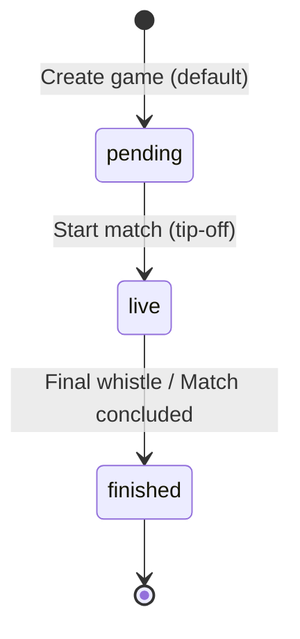

# Data Model Specification: Games Contracts and Endpoints

**Feature Branch**: `005-games-endpoints-contracts`  
**Status**: Completed  
**Date**: 2026-10-31  

This document specifies the data model for the `games` resource across all layers of the Hexagonal Architecture: Domain Model, Inbound Web DTOs, Outbound Persistence Entities, and the PostgreSQL database schema.

---

## 1. Domain Entities & Invariants (Core Layer)

### `Game` (`com.basketapp.bcmserver.domain.model.Game`)
Pure Java 21 domain entity with zero framework or persistence dependencies.

| Field | Type | Invariant Rules / Constraints |
| :--- | :--- | :--- |
| `id` | `Long` | Null for unpersisted games; positive (> 0) for existing/reconstituted games. |
| `teamId` | `Long` | Mandatory, non-null, positive (> 0). References home team. |
| `opponent` | `String` | Mandatory, non-null, trimmed, non-empty. Opponent team name. |
| `round` | `String` | Mandatory, non-null, trimmed, non-empty. Defaults to `"1"`. |
| `date` | `String` | Mandatory, non-null, trimmed, non-empty string (ISO-8601 or formatted match date). |
| `status` | `GameStatus` | Mandatory, non-null enum (`PENDING`, `LIVE`, `FINISHED`). Defaults to `PENDING`. |
| `createdAt` | `Instant` | Mandatory, non-null. Assigned upon creation or reconstituted from persistence. |
| **Scores (Own)** | | |
| `resultC1` | `int` | Non-negative integer (>= 0). Default `0`. Local team quarter 1 points. |
| `resultC2` | `int` | Non-negative integer (>= 0). Default `0`. Local team quarter 2 points. |
| `resultC3` | `int` | Non-negative integer (>= 0). Default `0`. Local team quarter 3 points. |
| `resultC4` | `int` | Non-negative integer (>= 0). Default `0`. Local team quarter 4 points. |
| `resultExtra` | `int` | Non-negative integer (>= 0). Default `0`. Local team overtime points. |
| **Scores (Opponent)** | | |
| `resultC1Opponent` | `int` | Non-negative integer (>= 0). Default `0`. Opponent quarter 1 points. |
| `resultC2Opponent` | `int` | Non-negative integer (>= 0). Default `0`. Opponent quarter 2 points. |
| `resultC3Opponent` | `int` | Non-negative integer (>= 0). Default `0`. Opponent quarter 3 points. |
| `resultC4Opponent` | `int` | Non-negative integer (>= 0). Default `0`. Opponent quarter 4 points. |
| `resultExtraOpponent` | `int` | Non-negative integer (>= 0). Default `0`. Opponent overtime points. |
| **Fouls (Own)** | | |
| `foulsC1` | `int` | Non-negative integer (>= 0). Default `0`. Local team quarter 1 fouls. |
| `foulsC2` | `int` | Non-negative integer (>= 0). Default `0`. Local team quarter 2 fouls. |
| `foulsC3` | `int` | Non-negative integer (>= 0). Default `0`. Local team quarter 3 fouls. |
| `foulsC4` | `int` | Non-negative integer (>= 0). Default `0`. Local team quarter 4 fouls. |
| `foulsExtra` | `int` | Non-negative integer (>= 0). Default `0`. Local team overtime fouls. |
| **Fouls (Opponent)** | | |
| `foulsC1Opponent` | `int` | Non-negative integer (>= 0). Default `0`. Opponent quarter 1 fouls. |
| `foulsC2Opponent` | `int` | Non-negative integer (>= 0). Default `0`. Opponent quarter 2 fouls. |
| `foulsC3Opponent` | `int` | Non-negative integer (>= 0). Default `0`. Opponent quarter 3 fouls. |
| `foulsC4Opponent` | `int` | Non-negative integer (>= 0). Default `0`. Opponent quarter 4 fouls. |
| `foulsExtraOpponent` | `int` | Non-negative integer (>= 0). Default `0`. Opponent overtime fouls. |

### `GameStatus` (`com.basketapp.bcmserver.domain.model.GameStatus`)
Domain enum representing match progression.

```java
public enum GameStatus {
    PENDING("pending"),
    LIVE("live"),
    FINISHED("finished");

    private final String value;

    GameStatus(String value) {
        this.value = value;
    }

    public String getValue() {
        return value;
    }

    public static GameStatus fromValue(String value) {
        if (value == null) return PENDING;
        for (GameStatus status : values()) {
            if (status.value.equalsIgnoreCase(value.trim())) {
                return status;
            }
        }
        throw new IllegalArgumentException("Invalid game status: " + value + ". Allowed values: pending, live, finished");
    }
}
```

### State Transitions


---

## 2. Inbound Application Commands & Use Cases

### `CreateGameCommand`
```java
public record CreateGameCommand(
    Long teamId,
    String opponent,
    String round,
    String date,
    String status,
    Integer resultC1,
    Integer resultC2,
    Integer resultC3,
    Integer resultC4,
    Integer resultExtra,
    Integer resultC1Opponent,
    Integer resultC2Opponent,
    Integer resultC3Opponent,
    Integer resultC4Opponent,
    Integer resultExtraOpponent,
    Integer foulsC1,
    Integer foulsC2,
    Integer foulsC3,
    Integer foulsC4,
    Integer foulsExtra,
    Integer foulsC1Opponent,
    Integer foulsC2Opponent,
    Integer foulsC3Opponent,
    Integer foulsC4Opponent,
    Integer foulsExtraOpponent
) {}
```

### `UpdateGameCommand`
```java
public record UpdateGameCommand(
    Long id,
    Long teamId,
    String opponent,
    String round,
    String date,
    String status,
    Integer resultC1,
    Integer resultC2,
    Integer resultC3,
    Integer resultC4,
    Integer resultExtra,
    Integer resultC1Opponent,
    Integer resultC2Opponent,
    Integer resultC3Opponent,
    Integer resultC4Opponent,
    Integer resultExtraOpponent,
    Integer foulsC1,
    Integer foulsC2,
    Integer foulsC3,
    Integer foulsC4,
    Integer foulsExtra,
    Integer foulsC1Opponent,
    Integer foulsC2Opponent,
    Integer foulsC3Opponent,
    Integer foulsC4Opponent,
    Integer foulsExtraOpponent
) {}
```

---

## 3. Web DTOs & Boundary Validation (Inbound Adapter)

### `CreateGameRequest` (`com.basketapp.bcmserver.infrastructure.adapter.in.web.dto.CreateGameRequest`)
```java
public record CreateGameRequest(
    @NotNull(message = "team_id is required")
    @Positive(message = "team_id must be a positive number")
    @JsonProperty("team_id")
    Long teamId,

    @NotBlank(message = "opponent cannot be blank")
    @Size(max = 255, message = "opponent cannot exceed 255 characters")
    @JsonProperty("opponent")
    String opponent,

    @JsonProperty("round")
    String round,

    @NotBlank(message = "date cannot be blank")
    @JsonProperty("date")
    String date,

    @Pattern(regexp = "^(pending|live|finished)?$", message = "status must be one of: pending, live, finished")
    @JsonProperty("status")
    String status,

    // Scores (Optional on create, default 0, must be >= 0)
    @Min(value = 0, message = "result_c1 must be >= 0") @JsonProperty("result_c1") Integer resultC1,
    @Min(value = 0, message = "result_c2 must be >= 0") @JsonProperty("result_c2") Integer resultC2,
    @Min(value = 0, message = "result_c3 must be >= 0") @JsonProperty("result_c3") Integer resultC3,
    @Min(value = 0, message = "result_c4 must be >= 0") @JsonProperty("result_c4") Integer resultC4,
    @Min(value = 0, message = "result_extra must be >= 0") @JsonProperty("result_extra") Integer resultExtra,
    @Min(value = 0, message = "result_c1_opponent must be >= 0") @JsonProperty("result_c1_opponent") Integer resultC1Opponent,
    @Min(value = 0, message = "result_c2_opponent must be >= 0") @JsonProperty("result_c2_opponent") Integer resultC2Opponent,
    @Min(value = 0, message = "result_c3_opponent must be >= 0") @JsonProperty("result_c3_opponent") Integer resultC3Opponent,
    @Min(value = 0, message = "result_c4_opponent must be >= 0") @JsonProperty("result_c4_opponent") Integer resultC4Opponent,
    @Min(value = 0, message = "result_extra_opponent must be >= 0") @JsonProperty("result_extra_opponent") Integer resultExtraOpponent,

    // Fouls (Optional on create, default 0, must be >= 0)
    @Min(value = 0, message = "fouls_c1 must be >= 0") @JsonProperty("fouls_c1") Integer foulsC1,
    @Min(value = 0, message = "fouls_c2 must be >= 0") @JsonProperty("fouls_c2") Integer foulsC2,
    @Min(value = 0, message = "fouls_c3 must be >= 0") @JsonProperty("fouls_c3") Integer foulsC3,
    @Min(value = 0, message = "fouls_c4 must be >= 0") @JsonProperty("fouls_c4") Integer foulsC4,
    @Min(value = 0, message = "fouls_extra must be >= 0") @JsonProperty("fouls_extra") Integer foulsExtra,
    @Min(value = 0, message = "fouls_c1_opponent must be >= 0") @JsonProperty("fouls_c1_opponent") Integer foulsC1Opponent,
    @Min(value = 0, message = "fouls_c2_opponent must be >= 0") @JsonProperty("fouls_c2_opponent") Integer foulsC2Opponent,
    @Min(value = 0, message = "fouls_c3_opponent must be >= 0") @JsonProperty("fouls_c3_opponent") Integer foulsC3Opponent,
    @Min(value = 0, message = "fouls_c4_opponent must be >= 0") @JsonProperty("fouls_c4_opponent") Integer foulsC4Opponent,
    @Min(value = 0, message = "fouls_extra_opponent must be >= 0") @JsonProperty("fouls_extra_opponent") Integer foulsExtraOpponent
) {}
```

### `UpdateGameRequest` (`com.basketapp.bcmserver.infrastructure.adapter.in.web.dto.UpdateGameRequest`)
```java
public record UpdateGameRequest(
    @NotNull(message = "team_id is required")
    @Positive(message = "team_id must be a positive number")
    @JsonProperty("team_id")
    Long teamId,

    @NotBlank(message = "opponent cannot be blank")
    @Size(max = 255, message = "opponent cannot exceed 255 characters")
    @JsonProperty("opponent")
    String opponent,

    @NotBlank(message = "round cannot be blank")
    @JsonProperty("round")
    String round,

    @NotBlank(message = "date cannot be blank")
    @JsonProperty("date")
    String date,

    @NotBlank(message = "status cannot be blank")
    @Pattern(regexp = "^(pending|live|finished)$", message = "status must be one of: pending, live, finished")
    @JsonProperty("status")
    String status,

    // Scores (Required on update, must be >= 0)
    @NotNull(message = "result_c1 is required") @Min(0) @JsonProperty("result_c1") Integer resultC1,
    @NotNull(message = "result_c2 is required") @Min(0) @JsonProperty("result_c2") Integer resultC2,
    @NotNull(message = "result_c3 is required") @Min(0) @JsonProperty("result_c3") Integer resultC3,
    @NotNull(message = "result_c4 is required") @Min(0) @JsonProperty("result_c4") Integer resultC4,
    @NotNull(message = "result_extra is required") @Min(0) @JsonProperty("result_extra") Integer resultExtra,
    @NotNull(message = "result_c1_opponent is required") @Min(0) @JsonProperty("result_c1_opponent") Integer resultC1Opponent,
    @NotNull(message = "result_c2_opponent is required") @Min(0) @JsonProperty("result_c2_opponent") Integer resultC2Opponent,
    @NotNull(message = "result_c3_opponent is required") @Min(0) @JsonProperty("result_c3_opponent") Integer resultC3Opponent,
    @NotNull(message = "result_c4_opponent is required") @Min(0) @JsonProperty("result_c4_opponent") Integer resultC4Opponent,
    @NotNull(message = "result_extra_opponent is required") @Min(0) @JsonProperty("result_extra_opponent") Integer resultExtraOpponent,

    // Fouls (Required on update, must be >= 0)
    @NotNull(message = "fouls_c1 is required") @Min(0) @JsonProperty("fouls_c1") Integer foulsC1,
    @NotNull(message = "fouls_c2 is required") @Min(0) @JsonProperty("fouls_c2") Integer foulsC2,
    @NotNull(message = "fouls_c3 is required") @Min(0) @JsonProperty("fouls_c3") Integer foulsC3,
    @NotNull(message = "fouls_c4 is required") @Min(0) @JsonProperty("fouls_c4") Integer foulsC4,
    @NotNull(message = "fouls_extra is required") @Min(0) @JsonProperty("fouls_extra") Integer foulsExtra,
    @NotNull(message = "fouls_c1_opponent is required") @Min(0) @JsonProperty("fouls_c1_opponent") Integer foulsC1Opponent,
    @NotNull(message = "fouls_c2_opponent is required") @Min(0) @JsonProperty("fouls_c2_opponent") Integer foulsC2Opponent,
    @NotNull(message = "fouls_c3_opponent is required") @Min(0) @JsonProperty("fouls_c3_opponent") Integer foulsC3Opponent,
    @NotNull(message = "fouls_c4_opponent is required") @Min(0) @JsonProperty("fouls_c4_opponent") Integer foulsC4Opponent,
    @NotNull(message = "fouls_extra_opponent is required") @Min(0) @JsonProperty("fouls_extra_opponent") Integer foulsExtraOpponent
) {}
```

### `GameResponse` (`com.basketapp.bcmserver.infrastructure.adapter.in.web.dto.GameResponse`)
```java
public record GameResponse(
    @JsonProperty("id") Long id,
    @JsonProperty("team_id") Long teamId,
    @JsonProperty("opponent") String opponent,
    @JsonProperty("round") String round,
    @JsonProperty("date") String date,
    @JsonProperty("status") String status,
    @JsonProperty("created_at") Instant createdAt,

    @JsonProperty("result_c1") int resultC1,
    @JsonProperty("result_c2") int resultC2,
    @JsonProperty("result_c3") int resultC3,
    @JsonProperty("result_c4") int resultC4,
    @JsonProperty("result_extra") int resultExtra,
    @JsonProperty("result_c1_opponent") int resultC1Opponent,
    @JsonProperty("result_c2_opponent") int resultC2Opponent,
    @JsonProperty("result_c3_opponent") int resultC3Opponent,
    @JsonProperty("result_c4_opponent") int resultC4Opponent,
    @JsonProperty("result_extra_opponent") int resultExtraOpponent,

    @JsonProperty("fouls_c1") int foulsC1,
    @JsonProperty("fouls_c2") int foulsC2,
    @JsonProperty("fouls_c3") int foulsC3,
    @JsonProperty("fouls_c4") int foulsC4,
    @JsonProperty("fouls_extra") int foulsExtra,
    @JsonProperty("fouls_c1_opponent") int foulsC1Opponent,
    @JsonProperty("fouls_c2_opponent") int foulsC2Opponent,
    @JsonProperty("fouls_c3_opponent") int foulsC3Opponent,
    @JsonProperty("fouls_c4_opponent") int foulsC4Opponent,
    @JsonProperty("fouls_extra_opponent") int foulsExtraOpponent
) {}
```

---

## 4. Persistence Entity & PostgreSQL Schema (Outbound Adapter)

### `GameJpaEntity` (`com.basketapp.bcmserver.infrastructure.adapter.out.persistence.entity.GameJpaEntity`)
```java
@Entity
@Table(name = "games")
public class GameJpaEntity {

    @Id
    @GeneratedValue(strategy = GenerationType.IDENTITY)
    private Long id;

    @Column(name = "team_id", nullable = false)
    private Long teamId;

    @Column(name = "opponent", nullable = false)
    private String opponent;

    @Column(name = "round", nullable = false)
    private String round;

    @Column(name = "date", nullable = false)
    private String date;

    @Column(name = "status", nullable = false)
    private String status;

    @Column(name = "created_at", nullable = false, updatable = false)
    private Instant createdAt;

    // Scores
    @Column(name = "result_c1", nullable = false) private int resultC1;
    @Column(name = "result_c2", nullable = false) private int resultC2;
    @Column(name = "result_c3", nullable = false) private int resultC3;
    @Column(name = "result_c4", nullable = false) private int resultC4;
    @Column(name = "result_extra", nullable = false) private int resultExtra;
    @Column(name = "result_c1_opponent", nullable = false) private int resultC1Opponent;
    @Column(name = "result_c2_opponent", nullable = false) private int resultC2Opponent;
    @Column(name = "result_c3_opponent", nullable = false) private int resultC3Opponent;
    @Column(name = "result_c4_opponent", nullable = false) private int resultC4Opponent;
    @Column(name = "result_extra_opponent", nullable = false) private int resultExtraOpponent;

    // Fouls
    @Column(name = "fouls_c1", nullable = false) private int foulsC1;
    @Column(name = "fouls_c2", nullable = false) private int foulsC2;
    @Column(name = "fouls_c3", nullable = false) private int foulsC3;
    @Column(name = "fouls_c4", nullable = false) private int foulsC4;
    @Column(name = "fouls_extra", nullable = false) private int foulsExtra;
    @Column(name = "fouls_c1_opponent", nullable = false) private int foulsC1Opponent;
    @Column(name = "fouls_c2_opponent", nullable = false) private int foulsC2Opponent;
    @Column(name = "fouls_c3_opponent", nullable = false) private int foulsC3Opponent;
    @Column(name = "fouls_c4_opponent", nullable = false) private int foulsC4Opponent;
    @Column(name = "fouls_extra_opponent", nullable = false) private int foulsExtraOpponent;

    // Constructors, Getters, Setters
}
```

### PostgreSQL DDL (`src/main/resources/db/migration/V4__create_games_table.sql`)
```sql
CREATE TABLE games (
    id BIGSERIAL PRIMARY KEY,
    team_id BIGINT NOT NULL,
    opponent TEXT NOT NULL,
    round TEXT NOT NULL DEFAULT '1',
    date TEXT NOT NULL,
    status TEXT NOT NULL DEFAULT 'pending',
    created_at TIMESTAMPTZ NOT NULL DEFAULT CURRENT_TIMESTAMP,

    result_c1 INTEGER NOT NULL DEFAULT 0,
    result_c2 INTEGER NOT NULL DEFAULT 0,
    result_c3 INTEGER NOT NULL DEFAULT 0,
    result_c4 INTEGER NOT NULL DEFAULT 0,
    result_extra INTEGER NOT NULL DEFAULT 0,
    result_c1_opponent INTEGER NOT NULL DEFAULT 0,
    result_c2_opponent INTEGER NOT NULL DEFAULT 0,
    result_c3_opponent INTEGER NOT NULL DEFAULT 0,
    result_c4_opponent INTEGER NOT NULL DEFAULT 0,
    result_extra_opponent INTEGER NOT NULL DEFAULT 0,

    fouls_c1 INTEGER NOT NULL DEFAULT 0,
    fouls_c2 INTEGER NOT NULL DEFAULT 0,
    fouls_c3 INTEGER NOT NULL DEFAULT 0,
    fouls_c4 INTEGER NOT NULL DEFAULT 0,
    fouls_extra INTEGER NOT NULL DEFAULT 0,
    fouls_c1_opponent INTEGER NOT NULL DEFAULT 0,
    fouls_c2_opponent INTEGER NOT NULL DEFAULT 0,
    fouls_c3_opponent INTEGER NOT NULL DEFAULT 0,
    fouls_c4_opponent INTEGER NOT NULL DEFAULT 0,
    fouls_extra_opponent INTEGER NOT NULL DEFAULT 0,

    CONSTRAINT fk_games_team FOREIGN KEY (team_id) REFERENCES teams (id) ON DELETE CASCADE
);

CREATE INDEX idx_games_team_id ON games (team_id);
```

