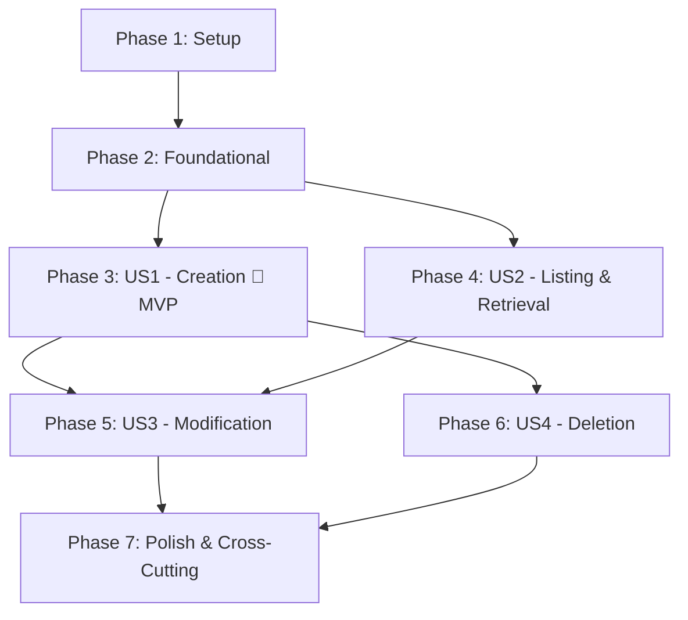

# Tasks: Games Contracts and Endpoints

**Input**: Design documents from `specs/005-games-endpoints-contracts/`  
**Prerequisites**: [plan.md](plan.md), [spec.md](spec.md), [research.md](research.md), [data-model.md](data-model.md), [contracts/games-api.yaml](contracts/games-api.yaml), [quickstart.md](quickstart.md)  
**Constitution**: Adheres strictly to [constitution.md](../../.specify/memory/constitution.md) (Hexagonal Architecture, Stateless JWT, Pre-DB Validation, Flyway migrations)

## Format: `- [ ] [ID] [P?] [Story?] Description with file path`

- **[P]**: Can run in parallel (different files, no blocking dependencies on incomplete tasks)
- **[Story]**: Maps to user stories from [spec.md](spec.md) (`[US1]`, `[US2]`, `[US3]`, `[US4]`)
- Every task includes explicit file paths

---

## Phase 1: Setup (Shared Infrastructure)

**Purpose**: Verification and shared infrastructure setup for the games feature

- [X] T001 Setup feature branch verification and ensure database connection and Flyway migration directory readiness in `src/main/resources/db/migration/`
- [X] T002 [P] Verify OpenAPI documentation configuration and route grouping for games in `src/main/java/com/basketapp/bcmserver/infrastructure/config/OpenApiConfig.java`

---

## Phase 2: Foundational (Blocking Prerequisites)

**Purpose**: Core infrastructure, database migration, domain model, and persistence layer that MUST be complete before ANY user story can be implemented

**⚠️ CRITICAL**: No user story implementation work can begin until this phase is complete.

- [X] T003 Create Flyway migration script for games table matching data model specifications in `src/main/resources/db/migration/V4__create_games_table.sql`
- [X] T004 [P] Create `GameStatus` enum with `pending`, `live`, `finished` string values in `src/main/java/com/basketapp/bcmserver/domain/model/GameStatus.java`
- [X] T005 [P] Create `GameNotFoundException` domain exception in `src/main/java/com/basketapp/bcmserver/domain/exception/GameNotFoundException.java`
- [X] T006 [P] Update `GlobalExceptionHandler` to handle `GameNotFoundException` returning RFC 7807 404 ProblemDetail in `src/main/java/com/basketapp/bcmserver/infrastructure/adapter/in/web/exception/GlobalExceptionHandler.java`
- [X] T007 Implement pure Java 21 `Game` domain entity with constructor invariants and score/foul validation in `src/main/java/com/basketapp/bcmserver/domain/model/Game.java`
- [X] T008 [P] Create unit tests verifying `Game` domain entity invariants and validation rules in `src/test/java/com/basketapp/bcmserver/domain/GameTest.java`
- [X] T009 [P] Create outbound `GameRepositoryPort` interface in `src/main/java/com/basketapp/bcmserver/application/port/out/GameRepositoryPort.java`
- [X] T010 [P] Create `GameJpaEntity` JPA persistence entity with all quarter score and foul columns in `src/main/java/com/basketapp/bcmserver/infrastructure/adapter/out/persistence/GameJpaEntity.java`
- [X] T011 [P] Create `SpringDataGameRepository` interface with `findByTeamId` query method in `src/main/java/com/basketapp/bcmserver/infrastructure/adapter/out/persistence/SpringDataGameRepository.java`
- [X] T012 [P] Create `GamePersistenceMapper` MapStruct mapper interface in `src/main/java/com/basketapp/bcmserver/infrastructure/adapter/out/persistence/mapper/GamePersistenceMapper.java`
- [X] T013 Implement `GameRepositoryAdapter` implementing `GameRepositoryPort` with transactional semantics in `src/main/java/com/basketapp/bcmserver/infrastructure/adapter/out/persistence/GameRepositoryAdapter.java`
- [X] T014 [P] Create persistence slice tests for `GameRepositoryAdapter` in `src/test/java/com/basketapp/bcmserver/infrastructure/adapter/out/persistence/GameRepositoryAdapterTest.java`

**Checkpoint**: Foundation ready - database schema, domain entity, repository port, and persistence adapter are complete and tested.

---

## Phase 3: User Story 1 - Authenticated Game Creation with Pre-DB Validation (Priority: P1) 🎯 MVP

**Goal**: Enable authenticated coaches/managers to schedule and create new games with pre-database validation, default scores/fouls/status, and foreign key verification for teams.

**Independent Test**: Send authenticated `POST /api/games` (and `POST /games`) with valid data to verify `201 Created` with full game JSON and `Location` header. Verify unauthenticated requests return `401 Unauthorized` before payload validation, invalid payloads return `400 Bad Request` without querying the database, and non-existent `team_id` returns `404 Not Found`.

### Implementation for User Story 1

- [X] T015 [P] [US1] Create `CreateGameCommand` application record in `src/main/java/com/basketapp/bcmserver/application/port/in/CreateGameCommand.java`
- [X] T016 [P] [US1] Create `CreateGameUseCase` inbound port interface in `src/main/java/com/basketapp/bcmserver/application/port/in/CreateGameUseCase.java`
- [X] T017 [P] [US1] Create `CreateGameRequest` web DTO record with `jakarta.validation` annotations in `src/main/java/com/basketapp/bcmserver/infrastructure/adapter/in/web/dto/CreateGameRequest.java`
- [X] T018 [P] [US1] Create `GameResponse` web DTO record serialized per OpenAPI contract in `src/main/java/com/basketapp/bcmserver/infrastructure/adapter/in/web/dto/GameResponse.java`
- [X] T019 [P] [US1] Create `GameWebMapper` MapStruct mapper interface in `src/main/java/com/basketapp/bcmserver/infrastructure/adapter/in/web/mapper/GameWebMapper.java`
- [X] T020 [US1] Implement `CreateGameUseCase` in `GameService` verifying team existence via `TeamRepositoryPort` and persisting defaults in `src/main/java/com/basketapp/bcmserver/application/service/GameService.java`
- [X] T021 [P] [US1] Create unit tests for `GameService.createGame` testing success and `TeamNotFoundException` in `src/test/java/com/basketapp/bcmserver/application/GameServiceTest.java`
- [X] T022 [US1] Implement `GameController` with `POST /api/games` (and path aliases `/games`, `/api/v1/games`), `@Validated`, `@Valid`, and Springdoc annotations in `src/main/java/com/basketapp/bcmserver/infrastructure/adapter/in/web/GameController.java`
- [X] T023 [P] [US1] Create web slice tests for game creation validating 201 Created and 400 Bad Request in `src/test/java/com/basketapp/bcmserver/infrastructure/adapter/in/web/GameControllerTest.java`
- [X] T024 [P] [US1] Create security precedence tests verifying 401 Unauthorized occurs before payload validation on POST in `src/test/java/com/basketapp/bcmserver/infrastructure/adapter/in/web/GameSecurityPrecedenceTest.java`

**Checkpoint**: User Story 1 (MVP) is fully functional and independently testable.

---

## Phase 4: User Story 2 - Authenticated Game Listing and Retrieval (Priority: P1)

**Goal**: Enable authenticated users to retrieve a list of all games (with optional `teamId` filtering) or retrieve full quarter scores and fouls for a specific game by ID.

**Independent Test**: Send authenticated `GET /api/games` and `GET /api/games?teamId={id}` verifying `200 OK` with JSON array. Send `GET /api/games/{id}` verifying `200 OK` with full score breakdown, or `404 Not Found` for non-existent IDs. Verify unauthenticated requests return `401 Unauthorized`.

### Implementation for User Story 2

- [X] T025 [P] [US2] Create `GetGameUseCase` inbound port interface with `findById`, `findAll`, and `findByTeamId` in `src/main/java/com/basketapp/bcmserver/application/port/in/GetGameUseCase.java`
- [X] T026 [US2] Implement `GetGameUseCase` methods in `GameService` in `src/main/java/com/basketapp/bcmserver/application/service/GameService.java`
- [X] T027 [P] [US2] Add unit tests for `GetGameUseCase` methods in `src/test/java/com/basketapp/bcmserver/application/GameServiceTest.java`
- [X] T028 [US2] Implement `GET /api/games` (with optional `teamId` filter) and `GET /api/games/{id}` endpoints in `src/main/java/com/basketapp/bcmserver/infrastructure/adapter/in/web/GameController.java`
- [X] T029 [P] [US2] Add web slice tests for `GET` endpoints covering list, query filter, and single resource retrieval in `src/test/java/com/basketapp/bcmserver/infrastructure/adapter/in/web/GameControllerTest.java`
- [X] T030 [P] [US2] Add security precedence tests verifying 401 Unauthorized for unauthenticated GET requests in `src/test/java/com/basketapp/bcmserver/infrastructure/adapter/in/web/GameSecurityPrecedenceTest.java`

**Checkpoint**: User Stories 1 and 2 are fully functional and independently testable.

---

## Phase 5: User Story 3 - Authenticated Game Modification and Score/Status Updates (Priority: P2)

**Goal**: Enable authenticated scorekeepers and coaches to update match attributes, status (`pending`, `live`, `finished`), quarter scores, and fouls via `PUT /api/games/{id}` with pre-DB validation.

**Independent Test**: Send authenticated `PUT /api/games/{id}` with updated scores and status verifying `200 OK` and persisted changes. Verify invalid payloads (negative scores, blank opponent, invalid status) return `400 Bad Request` without modifying the database. Verify non-existent game ID or non-existent `team_id` returns `404 Not Found`. Verify unauthenticated requests return `401 Unauthorized`.

### Implementation for User Story 3

- [X] T031 [P] [US3] Create `UpdateGameCommand` application record in `src/main/java/com/basketapp/bcmserver/application/port/in/UpdateGameCommand.java`
- [X] T032 [P] [US3] Create `UpdateGameUseCase` inbound port interface in `src/main/java/com/basketapp/bcmserver/application/port/in/UpdateGameUseCase.java`
- [X] T033 [P] [US3] Create `UpdateGameRequest` web DTO record with mandatory score and foul validations in `src/main/java/com/basketapp/bcmserver/infrastructure/adapter/in/web/dto/UpdateGameRequest.java`
- [X] T034 [US3] Add `toCommand(Long id, UpdateGameRequest request)` mapping method in `src/main/java/com/basketapp/bcmserver/infrastructure/adapter/in/web/mapper/GameWebMapper.java`
- [X] T035 [US3] Implement `UpdateGameUseCase` in `GameService` validating team existence and updating game state in `src/main/java/com/basketapp/bcmserver/application/service/GameService.java`
- [X] T036 [P] [US3] Add unit tests for `GameService.updateGame` testing happy path, invalid team, and missing game in `src/test/java/com/basketapp/bcmserver/application/GameServiceTest.java`
- [X] T037 [US3] Implement `PUT /api/games/{id}` endpoint with `@Positive` ID and `@Valid @RequestBody` in `src/main/java/com/basketapp/bcmserver/infrastructure/adapter/in/web/GameController.java`
- [X] T038 [P] [US3] Add web slice tests for `PUT /api/games/{id}` covering success, 400 Bad Request, and 404 Not Found in `src/test/java/com/basketapp/bcmserver/infrastructure/adapter/in/web/GameControllerTest.java`
- [X] T039 [P] [US3] Add security precedence tests verifying 401 Unauthorized before PUT payload validation in `src/test/java/com/basketapp/bcmserver/infrastructure/adapter/in/web/GameSecurityPrecedenceTest.java`

**Checkpoint**: User Stories 1, 2, and 3 are fully functional and independently testable.

---

## Phase 6: User Story 4 - Authenticated Game Deletion (Priority: P2)

**Goal**: Enable authenticated administrators to delete cancelled or duplicate game records with database cascading cleanup via `DELETE /api/games/{id}`.

**Independent Test**: Send authenticated `DELETE /api/games/{id}` verifying `204 No Content` and ensuring subsequent retrieval returns `404 Not Found`. Verify deleting non-existent game ID returns `404 Not Found`. Verify unauthenticated delete requests return `401 Unauthorized`.

### Implementation for User Story 4

- [X] T040 [P] [US4] Create `DeleteGameUseCase` inbound port interface in `src/main/java/com/basketapp/bcmserver/application/port/in/DeleteGameUseCase.java`
- [X] T041 [US4] Implement `DeleteGameUseCase` in `GameService` verifying game existence prior to deletion in `src/main/java/com/basketapp/bcmserver/application/service/GameService.java`
- [X] T042 [P] [US4] Add unit tests for `GameService.deleteGame` testing success and 404 behavior in `src/test/java/com/basketapp/bcmserver/application/GameServiceTest.java`
- [X] T043 [US4] Implement `DELETE /api/games/{id}` endpoint with `@Positive` ID in `src/main/java/com/basketapp/bcmserver/infrastructure/adapter/in/web/GameController.java`
- [X] T044 [P] [US4] Add web slice tests for `DELETE /api/games/{id}` in `src/test/java/com/basketapp/bcmserver/infrastructure/adapter/in/web/GameControllerTest.java`
- [X] T045 [P] [US4] Add security precedence tests verifying 401 Unauthorized for unauthenticated DELETE requests in `src/test/java/com/basketapp/bcmserver/infrastructure/adapter/in/web/GameSecurityPrecedenceTest.java`

**Checkpoint**: All user stories (US1-US4) are complete, functional, and independently testable.

---

## Phase 7: Polish & Cross-Cutting Concerns

**Purpose**: System integration, end-to-end verification, security hardening, and documentation alignment

- [X] T046 [P] Verify security filter chain rules for games route patterns in `src/main/java/com/basketapp/bcmserver/infrastructure/config/SecurityConfig.java`
- [X] T047 Verify generated Springdoc OpenAPI documentation matches `specs/005-games-endpoints-contracts/contracts/games-api.yaml`
- [X] T048 Execute full end-to-end manual validation using `curl` against Docker services per `specs/005-games-endpoints-contracts/quickstart.md`
- [X] T049 [P] Execute full Maven build and test suite (`./mvnw clean test`) to verify zero compiler warnings and all tests passing

---

## Dependencies & Execution Order

### Phase Dependencies



- **Setup (Phase 1)**: No dependencies - executes immediately.
- **Foundational (Phase 2)**: Depends on Setup completion - **BLOCKS** all user stories.
- **User Story 1 (Phase 3 - P1, MVP)**: Depends on Foundational phase completion. Creates the primary resource creation flow and initial web controller.
- **User Story 2 (Phase 4 - P1)**: Depends on Foundational phase completion. Extends service and controller with read operations.
- **User Story 3 (Phase 5 - P2)**: Depends on Foundational, US1, and US2 components. Adds update capability to existing service and controller.
- **User Story 4 (Phase 6 - P2)**: Depends on Foundational and US1 components. Adds delete capability to existing service and controller.
- **Polish (Phase 7)**: Depends on completion of all user stories.

### Parallel Opportunities

- **Phase 1**: T001 and T002 can run in parallel.
- **Phase 2**:
  - T004 (`GameStatus`), T005 (`GameNotFoundException`), T006 (`GlobalExceptionHandler`), T009 (`GameRepositoryPort`), T010 (`GameJpaEntity`), T011 (`SpringDataGameRepository`), and T012 (`GamePersistenceMapper`) can all run in parallel.
  - T008 (`GameTest`) can run in parallel once T007 (`Game`) is complete.
  - T014 (`GameRepositoryAdapterTest`) can run in parallel once T013 is complete.
- **Phase 3 (US1)**:
  - T015 (`CreateGameCommand`), T016 (`CreateGameUseCase`), T017 (`CreateGameRequest`), T018 (`GameResponse`), and T019 (`GameWebMapper`) can run in parallel.
  - T021 (`GameServiceTest`), T023 (`GameControllerTest`), and T024 (`GameSecurityPrecedenceTest`) can run in parallel once T020 and T022 are implemented.
- **Phase 4 (US2)**:
  - T025 (`GetGameUseCase`), T027 (`GameServiceTest` additions), T029 (`GameControllerTest` additions), and T030 (`GameSecurityPrecedenceTest` additions) can run in parallel across their files.
- **Phase 5 (US3)**:
  - T031 (`UpdateGameCommand`), T032 (`UpdateGameUseCase`), and T033 (`UpdateGameRequest`) can run in parallel.
  - T036, T038, and T039 can run in parallel once service and controller endpoints are updated.
- **Phase 6 (US4)**:
  - T040 (`DeleteGameUseCase`), T042, T044, and T045 can run in parallel.
- **Phase 7**:
  - T046 and T049 can run in parallel.

---

## Parallel Example: User Story 1

```bash
# Launch DTO and Port interfaces for US1 in parallel:
Task: "Create CreateGameCommand application record in src/main/java/com/basketapp/bcmserver/application/port/in/CreateGameCommand.java"
Task: "Create CreateGameUseCase inbound port interface in src/main/java/com/basketapp/bcmserver/application/port/in/CreateGameUseCase.java"
Task: "Create CreateGameRequest web DTO record with jakarta.validation annotations in src/main/java/com/basketapp/bcmserver/infrastructure/adapter/in/web/dto/CreateGameRequest.java"
Task: "Create GameResponse web DTO record in src/main/java/com/basketapp/bcmserver/infrastructure/adapter/in/web/dto/GameResponse.java"
Task: "Create GameWebMapper MapStruct mapper interface in src/main/java/com/basketapp/bcmserver/infrastructure/adapter/in/web/mapper/GameWebMapper.java"

# Once GameService and GameController are in place, run tests in parallel:
Task: "Create unit tests for GameService.createGame in src/test/java/com/basketapp/bcmserver/application/GameServiceTest.java"
Task: "Create web slice tests for game creation in src/test/java/com/basketapp/bcmserver/infrastructure/adapter/in/web/GameControllerTest.java"
Task: "Create security precedence tests in src/test/java/com/basketapp/bcmserver/infrastructure/adapter/in/web/GameSecurityPrecedenceTest.java"
```

---

## Implementation Strategy

### MVP First (User Story 1 Only)

1. Complete Phase 1: Setup (T001 - T002)
2. Complete Phase 2: Foundational (T003 - T014) — Flyway migration, domain entity, repository adapter
3. Complete Phase 3: User Story 1 (T015 - T024) — Creation endpoint with strict JWT precedence and pre-DB validation
4. **STOP and VALIDATE**: Run `GameSecurityPrecedenceTest` and `GameControllerTest` to verify MVP independently.

### Incremental Delivery

1. **Increment 1 (MVP)**: Setup + Foundational + User Story 1 (`POST /api/games`). Coaches can schedule games.
2. **Increment 2**: User Story 2 (`GET /api/games`, `GET /api/games/{id}`). Match schedules and scoreboards can be retrieved and viewed.
3. **Increment 3**: User Story 3 (`PUT /api/games/{id}`). Real-time scorekeeping, quarter-by-quarter score entry, foul tracking, and status transitions (`pending` -> `live` -> `finished`).
4. **Increment 4**: User Story 4 (`DELETE /api/games/{id}`). Administrative removal of cancelled matches with cascading integrity.
5. **Increment 5**: Polish (T046 - T049). End-to-end quickstart script execution, OpenAPI docs verification, and full build suite.

