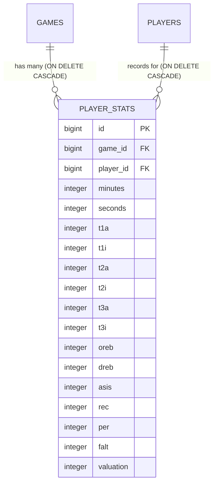

# Data Model Specification: Player Stats Contracts and Endpoints

**Feature Branch**: `006-player-stats-endpoints-contracts`  
**Status**: Completed  
**Date**: 2026-10-31  

This document specifies the data models, contracts, and schema representations for the `player_stats` resource across all layers of the Hexagonal Architecture: Domain Model, Application Layer, Inbound Web DTOs, Outbound Persistence Entities, and PostgreSQL database schema.

---

## 1. Domain Entities & Invariants (Core Layer)

### `PlayerStats` (`com.basketapp.bcmserver.domain.model.PlayerStats`)
Pure Java 21 domain entity with zero framework or persistence dependencies.

| Field | Type | Invariant Rules / Constraints | Description |
| :--- | :--- | :--- | :--- |
| `id` | `Long` | Null for new unpersisted records; positive (> 0) when reconstituted. | Unique identifier (Primary Key). |
| `gameId` | `Long` | Mandatory, non-null, positive (> 0). | Target game foreign identifier. |
| `playerId` | `Long` | Mandatory, non-null, positive (> 0). | Target player foreign identifier. |
| `minutes` | `int` | Integer >= 0. Default `0`. | Playing time minutes. |
| `seconds` | `int` | Integer between 0 and 59 inclusive (>= 0 and <= 59). Default `0`. | Playing time seconds. |
| `t1a` | `int` | Integer >= 0. Default `0`. | Free throws attempted. |
| `t1i` | `int` | Integer >= 0, must not exceed `t1a`. Default `0`. | Free throws made (scored). |
| `t2a` | `int` | Integer >= 0. Default `0`. | 2-point field goals attempted. |
| `t2i` | `int` | Integer >= 0, must not exceed `t2a`. Default `0`. | 2-point field goals made (scored). |
| `t3a` | `int` | Integer >= 0. Default `0`. | 3-point field goals attempted. |
| `t3i` | `int` | Integer >= 0, must not exceed `t3a`. Default `0`. | 3-point field goals made (scored). |
| `oreb` | `int` | Integer >= 0. Default `0`. | Offensive rebounds. |
| `dreb` | `int` | Integer >= 0. Default `0`. | Defensive rebounds. |
| `asis` | `int` | Integer >= 0. Default `0`. | Assists. |
| `rec` | `int` | Integer >= 0. Default `0`. | Steals / recoveries. |
| `per` | `int` | Integer >= 0. Default `0`. | Turnovers / ball losses. |
| `falt` | `int` | Integer >= 0. Default `0`. | Personal fouls committed. |
| `valuation` | `int` | Signed integer (can be negative, 0, or positive). Default `0`. | Performance Index Rating (PIR) score. |

### Domain Methods & Invariants
```java
public class PlayerStats {
    private final Long id;
    private Long gameId;
    private Long playerId;
    private int minutes;
    private int seconds;
    private int t1a;
    private int t1i;
    private int t2a;
    private int t2i;
    private int t3a;
    private int t3i;
    private int oreb;
    private int dreb;
    private int asis;
    private int rec;
    private int per;
    private int falt;
    private int valuation;

    // Factory for new instances
    public static PlayerStats create(Long gameId, Long playerId, int minutes, int seconds,
                                     int t1a, int t1i, int t2a, int t2i, int t3a, int t3i,
                                     int oreb, int dreb, int asis, int rec, int per, int falt,
                                     int valuation) { ... }

    // Reconstitution factory for persistence mapper
    public static PlayerStats reconstitute(Long id, Long gameId, Long playerId, int minutes, int seconds,
                                           int t1a, int t1i, int t2a, int t2i, int t3a, int t3i,
                                           int oreb, int dreb, int asis, int rec, int per, int falt,
                                           int valuation) { ... }

    // In-place mutation for updates
    public void update(Long gameId, Long playerId, int minutes, int seconds,
                       int t1a, int t1i, int t2a, int t2i, int t3a, int t3i,
                       int oreb, int dreb, int asis, int rec, int per, int falt,
                       int valuation) { ... }
}
```

---

## 2. Application Layer Ports & Commands

### Inbound Ports (`com.basketapp.bcmserver.application.port.in`)

#### `CreatePlayerStatsCommand`
```java
public record CreatePlayerStatsCommand(
    Long gameId,
    Long playerId,
    Integer minutes,
    Integer seconds,
    Integer t1a,
    Integer t1i,
    Integer t2a,
    Integer t2i,
    Integer t3a,
    Integer t3i,
    Integer oreb,
    Integer dreb,
    Integer asis,
    Integer rec,
    Integer per,
    Integer falt,
    Integer valuation
) {}
```

#### `UpdatePlayerStatsCommand`
```java
public record UpdatePlayerStatsCommand(
    Long id,
    Long gameId,
    Long playerId,
    Integer minutes,
    Integer seconds,
    Integer t1a,
    Integer t1i,
    Integer t2a,
    Integer t2i,
    Integer t3a,
    Integer t3i,
    Integer oreb,
    Integer dreb,
    Integer asis,
    Integer rec,
    Integer per,
    Integer falt,
    Integer valuation
) {}
```

#### Inbound Use Cases:
- `CreatePlayerStatsUseCase`: `PlayerStats createPlayerStats(CreatePlayerStatsCommand command)`
- `GetPlayerStatsUseCase`:
  - `PlayerStats getPlayerStatsById(Long id)`
  - `List<PlayerStats> getAllPlayerStats()`
  - `List<PlayerStats> getPlayerStatsByFilters(Long gameId, Long playerId)`
- `UpdatePlayerStatsUseCase`: `PlayerStats updatePlayerStats(UpdatePlayerStatsCommand command)`
- `DeletePlayerStatsUseCase`: `void deletePlayerStats(Long id)`

### Outbound Port (`com.basketapp.bcmserver.application.port.out.PlayerStatsRepositoryPort`)
```java
public interface PlayerStatsRepositoryPort {
    PlayerStats save(PlayerStats playerStats);
    Optional<PlayerStats> findById(Long id);
    List<PlayerStats> findAll();
    List<PlayerStats> findByGameId(Long gameId);
    List<PlayerStats> findByPlayerId(Long playerId);
    List<PlayerStats> findByGameIdAndPlayerId(Long gameId, Long playerId);
    void deleteById(Long id);
    boolean existsById(Long id);
}
```

---

## 3. Inbound Web DTOs & Validation Schema

### `CreatePlayerStatsRequest` (`com.basketapp.bcmserver.infrastructure.adapter.in.web.dto.CreatePlayerStatsRequest`)
```java
public record CreatePlayerStatsRequest(
    @NotNull(message = "game_id is required")
    @Positive(message = "game_id must be a positive integer")
    @JsonProperty("game_id")
    Long gameId,

    @NotNull(message = "player_id is required")
    @Positive(message = "player_id must be a positive integer")
    @JsonProperty("player_id")
    Long playerId,

    @Min(value = 0, message = "minutes must be greater than or equal to 0")
    @JsonProperty("minutes")
    Integer minutes,

    @Min(value = 0, message = "seconds must be between 0 and 59")
    @Max(value = 59, message = "seconds must be between 0 and 59")
    @JsonProperty("seconds")
    Integer seconds,

    @Min(value = 0, message = "t1a must be greater than or equal to 0")
    @JsonProperty("t1a")
    Integer t1a,

    @Min(value = 0, message = "t1i must be greater than or equal to 0")
    @JsonProperty("t1i")
    Integer t1i,

    @Min(value = 0, message = "t2a must be greater than or equal to 0")
    @JsonProperty("t2a")
    Integer t2a,

    @Min(value = 0, message = "t2i must be greater than or equal to 0")
    @JsonProperty("t2i")
    Integer t2i,

    @Min(value = 0, message = "t3a must be greater than or equal to 0")
    @JsonProperty("t3a")
    Integer t3a,

    @Min(value = 0, message = "t3i must be greater than or equal to 0")
    @JsonProperty("t3i")
    Integer t3i,

    @Min(value = 0, message = "oreb must be greater than or equal to 0")
    @JsonProperty("oreb")
    Integer oreb,

    @Min(value = 0, message = "dreb must be greater than or equal to 0")
    @JsonProperty("dreb")
    Integer dreb,

    @Min(value = 0, message = "asis must be greater than or equal to 0")
    @JsonProperty("asis")
    Integer asis,

    @Min(value = 0, message = "rec must be greater than or equal to 0")
    @JsonProperty("rec")
    Integer rec,

    @Min(value = 0, message = "per must be greater than or equal to 0")
    @JsonProperty("per")
    Integer per,

    @Min(value = 0, message = "falt must be greater than or equal to 0")
    @JsonProperty("falt")
    Integer falt,

    @JsonProperty("valuation")
    Integer valuation
) {}
```

### `UpdatePlayerStatsRequest` (`com.basketapp.bcmserver.infrastructure.adapter.in.web.dto.UpdatePlayerStatsRequest`)
Similar structure to `CreatePlayerStatsRequest`, requiring valid mandatory foreign keys and validated statistical metrics.

### `PlayerStatsResponse` (`com.basketapp.bcmserver.infrastructure.adapter.in.web.dto.PlayerStatsResponse`)
```java
public record PlayerStatsResponse(
    @JsonProperty("id") Long id,
    @JsonProperty("game_id") Long gameId,
    @JsonProperty("player_id") Long playerId,
    @JsonProperty("minutes") int minutes,
    @JsonProperty("seconds") int seconds,
    @JsonProperty("t1a") int t1a,
    @JsonProperty("t1i") int t1i,
    @JsonProperty("t2a") int t2a,
    @JsonProperty("t2i") int t2i,
    @JsonProperty("t3a") int t3a,
    @JsonProperty("t3i") int t3i,
    @JsonProperty("oreb") int oreb,
    @JsonProperty("dreb") int dreb,
    @JsonProperty("asis") int asis,
    @JsonProperty("rec") int rec,
    @JsonProperty("per") int per,
    @JsonProperty("falt") int falt,
    @JsonProperty("valuation") int valuation
) {}
```

---

## 4. Outbound Persistence JPA Model & Database Schema

### `PlayerStatsJpaEntity` (`com.basketapp.bcmserver.infrastructure.adapter.out.persistence.entity.PlayerStatsJpaEntity`)
```java
@Entity
@Table(name = "player_stats")
public class PlayerStatsJpaEntity {

    @Id
    @GeneratedValue(strategy = GenerationType.IDENTITY)
    private Long id;

    @Column(name = "game_id", nullable = false)
    private Long gameId;

    @Column(name = "player_id", nullable = false)
    private Long playerId;

    @Column(name = "minutes", nullable = false)
    private int minutes;

    @Column(name = "seconds", nullable = false)
    private int seconds;

    @Column(name = "t1a", nullable = false)
    private int t1a;

    @Column(name = "t1i", nullable = false)
    private int t1i;

    @Column(name = "t2a", nullable = false)
    private int t2a;

    @Column(name = "t2i", nullable = false)
    private int t2i;

    @Column(name = "t3a", nullable = false)
    private int t3a;

    @Column(name = "t3i", nullable = false)
    private int t3i;

    @Column(name = "oreb", nullable = false)
    private int oreb;

    @Column(name = "dreb", nullable = false)
    private int dreb;

    @Column(name = "asis", nullable = false)
    private int asis;

    @Column(name = "rec", nullable = false)
    private int rec;

    @Column(name = "per", nullable = false)
    private int per;

    @Column(name = "falt", nullable = false)
    private int falt;

    @Column(name = "valuation", nullable = false)
    private int valuation;
    
    // Constructors, Getters, Setters
}
```

### PostgreSQL DDL (`src/main/resources/db/migration/V5__create_player_stats_table.sql`)
```sql
CREATE TABLE player_stats (
    id BIGSERIAL PRIMARY KEY,
    game_id BIGINT NOT NULL,
    player_id BIGINT NOT NULL,
    minutes INTEGER NOT NULL DEFAULT 0,
    seconds INTEGER NOT NULL DEFAULT 0,
    t1a INTEGER NOT NULL DEFAULT 0,
    t1i INTEGER NOT NULL DEFAULT 0,
    t2a INTEGER NOT NULL DEFAULT 0,
    t2i INTEGER NOT NULL DEFAULT 0,
    t3a INTEGER NOT NULL DEFAULT 0,
    t3i INTEGER NOT NULL DEFAULT 0,
    oreb INTEGER NOT NULL DEFAULT 0,
    dreb INTEGER NOT NULL DEFAULT 0,
    asis INTEGER NOT NULL DEFAULT 0,
    rec INTEGER NOT NULL DEFAULT 0,
    per INTEGER NOT NULL DEFAULT 0,
    falt INTEGER NOT NULL DEFAULT 0,
    valuation INTEGER NOT NULL DEFAULT 0,
    CONSTRAINT fk_player_stats_game FOREIGN KEY (game_id) REFERENCES games (id) ON DELETE CASCADE,
    CONSTRAINT fk_player_stats_player FOREIGN KEY (player_id) REFERENCES players (id) ON DELETE CASCADE
);

CREATE INDEX idx_player_stats_game_id ON player_stats (game_id);
CREATE INDEX idx_player_stats_player_id ON player_stats (player_id);
CREATE INDEX idx_player_stats_game_player ON player_stats (game_id, player_id);
```

---

## 5. Object Mapping Matrix (MapStruct)

| Source Layer / Class | Target Layer / Class | Mapper Interface | Notes |
| :--- | :--- | :--- | :--- |
| `CreatePlayerStatsRequest` | `CreatePlayerStatsCommand` | `PlayerStatsWebMapper` | Maps request attributes to command record; defaults null counting fields to 0. |
| `UpdatePlayerStatsRequest` | `UpdatePlayerStatsCommand` | `PlayerStatsWebMapper` | Combines path ID and request body into command record. |
| `PlayerStats` (Domain) | `PlayerStatsResponse` (Web DTO) | `PlayerStatsWebMapper` | Formats domain model into external JSON response. |
| `PlayerStats` (Domain) | `PlayerStatsJpaEntity` (Persistence) | `PlayerStatsPersistenceMapper` | Converts domain model to JPA entity for saving. |
| `PlayerStatsJpaEntity` (Persistence) | `PlayerStats` (Domain) | `PlayerStatsPersistenceMapper` | Reconstitutes domain model from database record. |

---

## 6. Entity Relationships & Lifecycle Diagram



