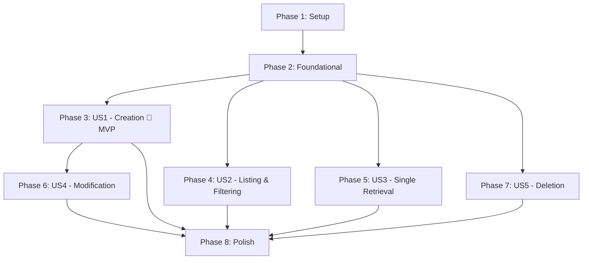

# Tasks: Player Stats Contracts and Endpoints

**Input**: Design documents from `specs/006-player-stats-endpoints-contracts/`  
**Prerequisites**: [plan.md](plan.md), [spec.md](spec.md), [research.md](research.md), [data-model.md](data-model.md), [contracts/player-stats-api.yaml](contracts/player-stats-api.yaml), [quickstart.md](quickstart.md)  
**Constitution**: Adheres strictly to [constitution.md](../../.specify/memory/constitution.md) (Hexagonal Architecture, Stateless JWT, Pre-DB Validation, Flyway migrations)

## Format: `- [ ] [ID] [P?] [Story?] Description with file path`

- **[P]**: Can run in parallel (different files, no blocking dependencies on incomplete tasks)
- **[Story]**: Maps to user stories from [spec.md](spec.md) (`[US1]`, `[US2]`, `[US3]`, `[US4]`, `[US5]`)
- Every task includes explicit file paths

---

## Phase 1: Setup (Shared Infrastructure)

**Purpose**: Verification and shared infrastructure setup for the player stats feature

- [x] T001 Setup feature branch verification and verify database connection and Flyway migration directory readiness in `src/main/resources/db/migration/`
- [x] T002 [P] Verify OpenAPI documentation configuration and security scheme for player stats in `src/main/java/com/basketapp/bcmserver/infrastructure/config/OpenApiConfig.java`

---

## Phase 2: Foundational (Blocking Prerequisites)

**Purpose**: Core infrastructure, database migration, domain model, and persistence layer that MUST be complete before ANY user story can be implemented

**⚠️ CRITICAL**: No user story implementation work can begin until this phase is complete.

- [x] T003 Create Flyway migration script for player_stats table matching data model specifications in `src/main/resources/db/migration/V5__create_player_stats_table.sql`
- [x] T004 [P] Create `PlayerStatsNotFoundException` domain exception in `src/main/java/com/basketapp/bcmserver/domain/exception/PlayerStatsNotFoundException.java`
- [x] T005 [P] Update `GlobalExceptionHandler` to handle `PlayerStatsNotFoundException` returning RFC 7807 404 ProblemDetail in `src/main/java/com/basketapp/bcmserver/infrastructure/adapter/in/web/exception/GlobalExceptionHandler.java`
- [x] T006 Implement pure Java 21 `PlayerStats` domain entity with constructor invariants, bounds checking, and factory methods in `src/main/java/com/basketapp/bcmserver/domain/model/PlayerStats.java`
- [x] T007 [P] Create unit tests verifying `PlayerStats` domain entity invariants and validation rules in `src/test/java/com/basketapp/bcmserver/domain/PlayerStatsTest.java`
- [x] T008 [P] Create outbound `PlayerStatsRepositoryPort` interface in `src/main/java/com/basketapp/bcmserver/application/port/out/PlayerStatsRepositoryPort.java`
- [x] T009 [P] Create `PlayerStatsJpaEntity` JPA persistence entity with all time and counting statistic columns in `src/main/java/com/basketapp/bcmserver/infrastructure/adapter/out/persistence/PlayerStatsJpaEntity.java`
- [x] T010 [P] Create `SpringDataPlayerStatsRepository` interface with `findByGameId`, `findByPlayerId`, and `findByGameIdAndPlayerId` query methods in `src/main/java/com/basketapp/bcmserver/infrastructure/adapter/out/persistence/SpringDataPlayerStatsRepository.java`
- [x] T011 [P] Create `PlayerStatsPersistenceMapper` MapStruct mapper interface in `src/main/java/com/basketapp/bcmserver/infrastructure/adapter/out/persistence/mapper/PlayerStatsPersistenceMapper.java`
- [x] T012 Implement `PlayerStatsRepositoryAdapter` implementing `PlayerStatsRepositoryPort` with transactional semantics in `src/main/java/com/basketapp/bcmserver/infrastructure/adapter/out/persistence/PlayerStatsRepositoryAdapter.java`
- [x] T013 [P] Create persistence slice tests for `PlayerStatsRepositoryAdapter` in `src/test/java/com/basketapp/bcmserver/infrastructure/adapter/out/persistence/PlayerStatsRepositoryAdapterTest.java`

**Checkpoint**: Foundation ready - database schema, domain entity, repository port, and persistence adapter are complete and tested.

---

## Phase 3: User Story 1 - Authenticated Player Stats Creation with Pre-DB Validation (Priority: P1) 🎯 MVP

**Goal**: Enable authenticated users to record game statistics for a player with pre-database validation, default statistical counters, and foreign key verification for game and player.

**Independent Test**: Send authenticated `POST /api/player-stats` (and aliases `/player-stats`, `/api/v1/player-stats`) with valid stats to verify `201 Created` with full player stats JSON and `Location` header. Verify unauthenticated requests return `401 Unauthorized` before payload validation, invalid payloads return `400 Bad Request` without querying the database, and non-existent `game_id` or `player_id` returns `404 Not Found`.

### Implementation for User Story 1

- [x] T014 [P] [US1] Create `CreatePlayerStatsCommand` application record in `src/main/java/com/basketapp/bcmserver/application/port/in/CreatePlayerStatsCommand.java`
- [x] T015 [P] [US1] Create `CreatePlayerStatsUseCase` inbound port interface in `src/main/java/com/basketapp/bcmserver/application/port/in/CreatePlayerStatsUseCase.java`
- [x] T016 [P] [US1] Create `CreatePlayerStatsRequest` web DTO record with `jakarta.validation` annotations in `src/main/java/com/basketapp/bcmserver/infrastructure/adapter/in/web/dto/CreatePlayerStatsRequest.java`
- [x] T017 [P] [US1] Create `PlayerStatsResponse` web DTO record serialized per OpenAPI contract in `src/main/java/com/basketapp/bcmserver/infrastructure/adapter/in/web/dto/PlayerStatsResponse.java`
- [x] T018 [P] [US1] Create `PlayerStatsWebMapper` MapStruct mapper interface in `src/main/java/com/basketapp/bcmserver/infrastructure/adapter/in/web/mapper/PlayerStatsWebMapper.java`
- [x] T019 [US1] Implement `CreatePlayerStatsUseCase` in `PlayerStatsService` verifying `GameRepositoryPort.existsById` and `PlayerRepositoryPort.existsById` before persisting in `src/main/java/com/basketapp/bcmserver/application/service/PlayerStatsService.java`
- [x] T020 [P] [US1] Create unit tests for `PlayerStatsService.createPlayerStats` testing success, `GameNotFoundException`, and `PlayerNotFoundException` in `src/test/java/com/basketapp/bcmserver/application/PlayerStatsServiceTest.java`
- [x] T021 [US1] Implement `PlayerStatsController` with `POST /api/player-stats` (and path aliases `/player-stats`, `/api/v1/player-stats`), `@Validated`, `@Valid`, and Springdoc OpenAPI annotations in `src/main/java/com/basketapp/bcmserver/infrastructure/adapter/in/web/PlayerStatsController.java`
- [x] T022 [P] [US1] Create web slice tests for player stats creation validating 201 Created and 400 Bad Request in `src/test/java/com/basketapp/bcmserver/infrastructure/adapter/in/web/PlayerStatsControllerTest.java`
- [x] T023 [P] [US1] Create security precedence tests verifying 401 Unauthorized occurs before payload validation on POST in `src/test/java/com/basketapp/bcmserver/infrastructure/adapter/in/web/PlayerStatsSecurityPrecedenceTest.java`

**Checkpoint**: User Story 1 (MVP) is fully functional and independently testable.

---

## Phase 4: User Story 2 - Authenticated Player Stats Listing and Filtered Search (Priority: P1)

**Goal**: Enable authenticated users to retrieve a list of player statistics, with optional filtering by `gameId`, by `playerId`, or by both.

**Independent Test**: Send authenticated `GET /api/player-stats`, `GET /api/player-stats?gameId={id}`, `GET /api/player-stats?playerId={id}`, and combined filter verifying `200 OK` with JSON array. Verify invalid filter params return `400 Bad Request`. Verify unauthenticated requests return `401 Unauthorized`.

### Implementation for User Story 2

- [x] T024 [P] [US2] Create `GetPlayerStatsUseCase` inbound port interface with `getAllPlayerStats` and `getPlayerStatsByFilters` in `src/main/java/com/basketapp/bcmserver/application/port/in/GetPlayerStatsUseCase.java`
- [x] T025 [US2] Implement `GetPlayerStatsUseCase` listing and filtering methods in `PlayerStatsService` in `src/main/java/com/basketapp/bcmserver/application/service/PlayerStatsService.java`
- [x] T026 [P] [US2] Add unit tests for `GetPlayerStatsUseCase` listing and filtering methods in `src/test/java/com/basketapp/bcmserver/application/PlayerStatsServiceTest.java`
- [x] T027 [US2] Implement `GET /api/player-stats` endpoint with optional `@Positive` `gameId` and `playerId` query parameters and OpenAPI docs in `src/main/java/com/basketapp/bcmserver/infrastructure/adapter/in/web/PlayerStatsController.java`
- [x] T028 [P] [US2] Add web slice tests for `GET /api/player-stats` covering all stats, filtering by gameId, filtering by playerId, and invalid query parameters in `src/test/java/com/basketapp/bcmserver/infrastructure/adapter/in/web/PlayerStatsControllerTest.java`
- [x] T029 [P] [US2] Add security precedence tests verifying 401 Unauthorized for unauthenticated GET collection requests in `src/test/java/com/basketapp/bcmserver/infrastructure/adapter/in/web/PlayerStatsSecurityPrecedenceTest.java`

**Checkpoint**: User Stories 1 and 2 are fully functional and independently testable.

---

## Phase 5: User Story 3 - Authenticated Single Player Stats Retrieval (Priority: P1)

**Goal**: Enable authenticated clients to fetch a single player statistics record by its unique identifier.

**Independent Test**: Send authenticated `GET /api/player-stats/{id}` verifying `200 OK` with full statistics breakdown, or `404 Not Found` for non-existent IDs. Verify invalid ID format returns `400 Bad Request`. Verify unauthenticated requests return `401 Unauthorized`.

### Implementation for User Story 3

- [x] T030 [US3] Add `getPlayerStatsById` method to `GetPlayerStatsUseCase` inbound port interface in `src/main/java/com/basketapp/bcmserver/application/port/in/GetPlayerStatsUseCase.java`
- [x] T031 [US3] Implement `getPlayerStatsById` in `PlayerStatsService` throwing `PlayerStatsNotFoundException` if missing in `src/main/java/com/basketapp/bcmserver/application/service/PlayerStatsService.java`
- [x] T032 [P] [US3] Add unit tests for `PlayerStatsService.getPlayerStatsById` testing success and 404 behavior in `src/test/java/com/basketapp/bcmserver/application/PlayerStatsServiceTest.java`
- [x] T033 [US3] Implement `GET /api/player-stats/{id}` endpoint with `@Positive` ID and OpenAPI annotations in `src/main/java/com/basketapp/bcmserver/infrastructure/adapter/in/web/PlayerStatsController.java`
- [x] T034 [P] [US3] Add web slice tests for `GET /api/player-stats/{id}` covering success, 404 Not Found, and 400 Bad Request for invalid IDs in `src/test/java/com/basketapp/bcmserver/infrastructure/adapter/in/web/PlayerStatsControllerTest.java`
- [x] T035 [P] [US3] Add security precedence tests verifying 401 Unauthorized for unauthenticated single item GET requests in `src/test/java/com/basketapp/bcmserver/infrastructure/adapter/in/web/PlayerStatsSecurityPrecedenceTest.java`

**Checkpoint**: User Stories 1, 2, and 3 are fully functional and independently testable.

---

## Phase 6: User Story 4 - Authenticated Player Stats Modification (Priority: P2)

**Goal**: Enable authenticated scorekeepers and statisticians to update existing player statistics via `PUT /api/player-stats/{id}` with pre-DB validation and foreign key existence verification.

**Independent Test**: Send authenticated `PUT /api/player-stats/{id}` with updated statistics verifying `200 OK` and persisted updates. Verify invalid payloads (negative stats, invalid seconds, made > attempted) return `400 Bad Request` without modifying the database. Verify non-existent player stats ID, non-existent `game_id`, or non-existent `player_id` returns `404 Not Found`. Verify unauthenticated requests return `401 Unauthorized`.

### Implementation for User Story 4

- [x] T036 [P] [US4] Create `UpdatePlayerStatsCommand` application record in `src/main/java/com/basketapp/bcmserver/application/port/in/UpdatePlayerStatsCommand.java`
- [x] T037 [P] [US4] Create `UpdatePlayerStatsUseCase` inbound port interface in `src/main/java/com/basketapp/bcmserver/application/port/in/UpdatePlayerStatsUseCase.java`
- [x] T038 [P] [US4] Create `UpdatePlayerStatsRequest` web DTO record with `jakarta.validation` annotations in `src/main/java/com/basketapp/bcmserver/infrastructure/adapter/in/web/dto/UpdatePlayerStatsRequest.java`
- [x] T039 [US4] Add `toCommand(Long id, UpdatePlayerStatsRequest request)` mapping method in `src/main/java/com/basketapp/bcmserver/infrastructure/adapter/in/web/mapper/PlayerStatsWebMapper.java`
- [x] T040 [US4] Implement `UpdatePlayerStatsUseCase` in `PlayerStatsService` verifying target record, game, and player existence in `src/main/java/com/basketapp/bcmserver/application/service/PlayerStatsService.java`
- [x] T041 [P] [US4] Add unit tests for `PlayerStatsService.updatePlayerStats` testing happy path, missing stats record, missing game, and missing player in `src/test/java/com/basketapp/bcmserver/application/PlayerStatsServiceTest.java`
- [x] T042 [US4] Implement `PUT /api/player-stats/{id}` endpoint with `@Positive` ID, `@Valid @RequestBody`, and OpenAPI docs in `src/main/java/com/basketapp/bcmserver/infrastructure/adapter/in/web/PlayerStatsController.java`
- [x] T043 [P] [US4] Add web slice tests for `PUT /api/player-stats/{id}` covering success, 400 Bad Request, and 404 Not Found in `src/test/java/com/basketapp/bcmserver/infrastructure/adapter/in/web/PlayerStatsControllerTest.java`
- [x] T044 [P] [US4] Add security precedence tests verifying 401 Unauthorized before PUT payload validation in `src/test/java/com/basketapp/bcmserver/infrastructure/adapter/in/web/PlayerStatsSecurityPrecedenceTest.java`

**Checkpoint**: User Stories 1, 2, 3, and 4 are fully functional and independently testable.

---

## Phase 7: User Story 5 - Authenticated Player Stats Deletion (Priority: P2)

**Goal**: Enable authenticated administrators or statisticians to delete a player statistics record via `DELETE /api/player-stats/{id}`.

**Independent Test**: Send authenticated `DELETE /api/player-stats/{id}` verifying `204 No Content` and ensuring subsequent retrieval returns `404 Not Found`. Verify deleting non-existent ID returns `404 Not Found`. Verify unauthenticated delete requests return `401 Unauthorized`.

### Implementation for User Story 5

- [x] T045 [P] [US5] Create `DeletePlayerStatsUseCase` inbound port interface in `src/main/java/com/basketapp/bcmserver/application/port/in/DeletePlayerStatsUseCase.java`
- [x] T046 [US5] Implement `DeletePlayerStatsUseCase` in `PlayerStatsService` verifying record existence prior to deletion in `src/main/java/com/basketapp/bcmserver/application/service/PlayerStatsService.java`
- [x] T047 [P] [US5] Add unit tests for `PlayerStatsService.deletePlayerStats` testing success and 404 behavior in `src/test/java/com/basketapp/bcmserver/application/PlayerStatsServiceTest.java`
- [x] T048 [US5] Implement `DELETE /api/player-stats/{id}` endpoint with `@Positive` ID and OpenAPI docs in `src/main/java/com/basketapp/bcmserver/infrastructure/adapter/in/web/PlayerStatsController.java`
- [x] T049 [P] [US5] Add web slice tests for `DELETE /api/player-stats/{id}` in `src/test/java/com/basketapp/bcmserver/infrastructure/adapter/in/web/PlayerStatsControllerTest.java`
- [x] T050 [P] [US5] Add security precedence tests verifying 401 Unauthorized for unauthenticated DELETE requests in `src/test/java/com/basketapp/bcmserver/infrastructure/adapter/in/web/PlayerStatsSecurityPrecedenceTest.java`

**Checkpoint**: All user stories (US1-US5) are complete, functional, and independently testable.

---

## Phase 8: Polish & Cross-Cutting Concerns

**Purpose**: System integration, end-to-end verification, security hardening, and documentation alignment

- [x] T051 [P] Verify security filter chain rules for player stats route patterns (`/api/player-stats/**`, `/player-stats/**`, `/api/v1/player-stats/**`) in `src/main/java/com/basketapp/bcmserver/infrastructure/config/SecurityConfig.java`
- [x] T052 Verify generated Springdoc OpenAPI documentation matches `specs/006-player-stats-endpoints-contracts/contracts/player-stats-api.yaml`
- [x] T053 Execute full end-to-end manual validation using `curl` against Docker services per `specs/006-player-stats-endpoints-contracts/quickstart.md`
- [x] T054 [P] Execute full Maven build and test suite (`./mvnw clean test`) to verify zero compiler warnings and all tests passing

---

## Dependencies & Execution Order

### Phase Dependencies



### User Story Dependencies

- **User Story 1 (P1 - Creation) 🎯 MVP**: Depends on Phase 2 Foundational. Can start immediately once foundational components are ready.
- **User Story 2 (P1 - Listing & Filtering)**: Depends on Phase 2 Foundational. Can proceed in parallel with US1.
- **User Story 3 (P1 - Single Retrieval)**: Depends on Phase 2 Foundational and shares `GetPlayerStatsUseCase` with US2.
- **User Story 4 (P2 - Modification)**: Depends on Phase 2 Foundational and builds on models created in US1.
- **User Story 5 (P2 - Deletion)**: Depends on Phase 2 Foundational. Can proceed independently.

### Within Each User Story

- Commands and Inbound Ports before Services
- Web DTOs and Mappers before Controllers
- Service implementation coordinates domain and outbound ports
- Controllers implement HTTP endpoints with boundary validation
- Web slice tests (`@WebMvcTest`) and security tests verify behavior

### Parallel Opportunities

- **Phase 1**: T001 and T002 can run in parallel.
- **Phase 2**: T004, T005, T007, T008, T009, T010, T011, T013 can run in parallel across domain, web exception handling, and persistence layers.
- **Phase 3 (US1)**: T014, T015, T016, T017, T018 can be created in parallel; T020, T022, T023 can run in parallel once Service and Controller are ready.
- **Phase 4 (US2)**: T024 can be created in parallel; T026, T028, T029 can run in parallel.
- **Phase 5 (US3)**: T032, T034, T035 can run in parallel.
- **Phase 6 (US4)**: T036, T037, T038 can run in parallel; T041, T043, T044 can run in parallel.
- **Phase 7 (US5)**: T045 can run in parallel; T047, T049, T050 can run in parallel.
- **Phase 8**: T051 and T054 can run in parallel.

---

## Parallel Example: User Story 1

```bash
# Launch DTO and Port generation for User Story 1 in parallel:
Task: "Create CreatePlayerStatsCommand application record in src/main/java/com/basketapp/bcmserver/application/port/in/CreatePlayerStatsCommand.java"
Task: "Create CreatePlayerStatsUseCase inbound port interface in src/main/java/com/basketapp/bcmserver/application/port/in/CreatePlayerStatsUseCase.java"
Task: "Create CreatePlayerStatsRequest web DTO record in src/main/java/com/basketapp/bcmserver/infrastructure/adapter/in/web/dto/CreatePlayerStatsRequest.java"
Task: "Create PlayerStatsResponse web DTO record in src/main/java/com/basketapp/bcmserver/infrastructure/adapter/in/web/dto/PlayerStatsResponse.java"
Task: "Create PlayerStatsWebMapper MapStruct mapper in src/main/java/com/basketapp/bcmserver/infrastructure/adapter/in/web/mapper/PlayerStatsWebMapper.java"

# Launch test tasks for User Story 1 in parallel once code is wired:
Task: "Create unit tests for PlayerStatsService.createPlayerStats in src/test/java/com/basketapp/bcmserver/application/PlayerStatsServiceTest.java"
Task: "Create web slice tests for player stats creation in src/test/java/com/basketapp/bcmserver/infrastructure/adapter/in/web/PlayerStatsControllerTest.java"
Task: "Create security precedence tests verifying 401 Unauthorized in src/test/java/com/basketapp/bcmserver/infrastructure/adapter/in/web/PlayerStatsSecurityPrecedenceTest.java"
```

---

## Implementation Strategy

### MVP First (User Story 1 Only)

1. Complete Phase 1: Setup
2. Complete Phase 2: Foundational (CRITICAL - blocks all stories)
3. Complete Phase 3: User Story 1
4. **STOP and VALIDATE**: Test User Story 1 independently with unit, web slice, and security tests
5. Verify creation of player stats with pre-DB validation and foreign key checks

### Incremental Delivery

1. Complete Setup + Foundational → Database schema, domain entity, and persistence layer ready
2. Add User Story 1 → Player stats creation with defaults and FK checks (MVP!)
3. Add User Story 2 → Player stats listing with optional `gameId` and `playerId` filtering
4. Add User Story 3 → Single player stats retrieval by unique identifier
5. Add User Story 4 → Player stats update with pre-DB validation
6. Add User Story 5 → Player stats deletion with cascading integrity
7. Polish & Cross-Cutting → Full test suite, OpenAPI verification, and end-to-end curl scenarios

---

## Notes

- All tasks follow the strict format: `- [ ] [TaskID] [P?] [Story?] Description with file path`
- `[P]` tasks operate on different files with no pending dependencies
- `[Story]` labels indicate which user story (`[US1]` through `[US5]`) the task implements
- Pre-database validation is verified via `@WebMvcTest` slice tests without loading full Spring context
- Token validation precedence (401 before 400) is verified via dedicated security precedence slice tests
- Foreign key verification for `game_id` and `player_id` ensures RFC 7807 404 responses before persistence

